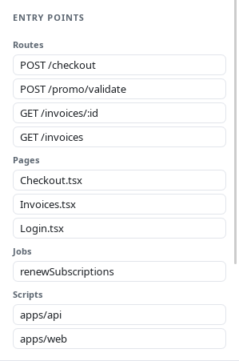
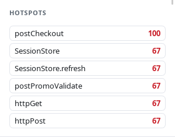

Understand an unfamiliar repository.

## Explore mode

The **Explore the repo** button, at the top of the left sidebar, switches from review to exploration; **Review the PR** switches back. In exploration, the map shows the repository as it is at the head commit, without a diff: no change colours, no removed files or old locations, no removed edges. The map, the panels and the search stay the same.

## Entry points

The **Entry points** section of the left sidebar lists where the code starts, grouped by kind:

- **Routes**: the declared HTTP routes (`app.get("/invoices", …)`);
- **Pages**: the components under a `pages/` folder;
- **Jobs**: the exported functions under a `jobs/` folder;
- **Scripts**: the packages that declare `scripts` in their `package.json` (`start`, `dev`, `test`…).

Click an entry point to select it on the map. On acme-shop, relief finds 4 routes, 3 pages (Checkout, Invoices, Login) the `renewSubscriptions` job, and the scripts of `@acme/api` and `@acme/web`.

Below it, the **Overview** counts the repository: the detector used, the number of packages, external dependencies, files and symbols, and the links by type.



## Follow a flow

In exploration, click an entry point: relief selects it and traces everything it depends on, step by step, down to the external dependencies (npm packages such as `stripe-sdk`). It is the [impact radius](../review/#impact-radius) in the **Dependencies** direction: the reached nodes are highlighted on the map, the rest is dimmed, and the panel lists the nodes by depth. An external package counts one hop more than the symbol whose file imports it.

On acme-shop, `POST /checkout` leads to `computeTotal` and `chargeCustomer` (direct), then on to `stripe-sdk`.

## Hotspots: where to look first

In exploration, the **Hotspots** section lists the 6 riskiest symbols of the repository. Click one to select it. The risk combines three measures:

- **churn**: the number of commits in the last 90 days that touch the symbol (or the file), counted from the date of the displayed commit;
- **complexity**: the cyclomatic complexity (each `if`, loop, `case`, `catch`, ternary, `&&`, `||` or `??` adds a path);
- **tests**: a symbol that no test reaches counts double.

The risk is complexity × churn × (2 without a test), scaled between 0 and 1 by the riskiest symbol. A symbol that did not change in the period is not a hotspot.

The churn of a file is exact. The churn of a symbol is an approximation: relief compares the lines each commit touched with the current place of the symbol, without following lines moved since. A file counts as tested as soon as a test reaches one of its symbols.

The panel of a node shows its **Metrics**: churn, complexity, main author over the period and whether it is tested. The [Risk map](../map/#risk-map) layer colours the whole map by this risk.

These measures depend on the history: relief computes them apart and keeps them in `.relief/cache/`, without changing the map itself.



## Logical coupling

Some files often change together without depending on each other in the code: a file and its doc, a schema and its migrations, two services that share a format. The **Logical coupling** layer, in the Layers menu, links them with dashed edges of another colour.

relief draws them from the git history, not from the code: this layer works on **any repository**, even without a language adapter (Markdown, YAML, shell…).

- Two files are coupled when at least 2 commits change them together in the 90 days before the displayed commit.
- Commits that touch more than 30 files (renames, mass reformatting) are ignored: they would link everything to everything.
- For each pair, relief also computes the **confidence**: the share of the commits of the most changed file that also touch the other one.

The threshold is set in `relief.config.yaml`:

```yaml
co_change:
  min_commits: 3
```

Like the hotspots, this computation is kept in `.relief/cache/` and does not change the map itself.

## Search a symbol

Coming soon: this feature does not exist yet.

## Impact of a change

Coming soon: this feature does not exist yet.
