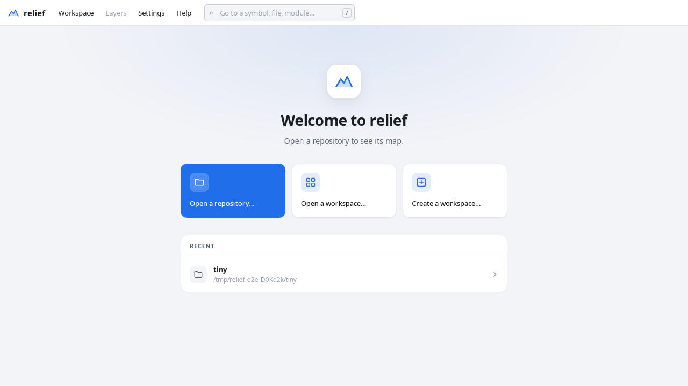

relief is a desktop app that shows a zoomable map of your git repository, locally, in its own window. You start it from a terminal with the `relief` command.

## Install

### In one command, without admin rights

From a clone of the repository, one command builds relief from the current branch (uncommitted changes included) and installs it in your user folder, without `sudo`. It detects the OS and only needs Docker on Linux and Windows.

```sh
./install.sh
```

On Windows, from PowerShell: `.\install.ps1`.

- **Linux**: built in a Docker container (Ubuntu 22.04, so it runs on any distribution with glibc 2.35 or later), then installed in `~/.local/share/relief/`, with the `~/.local/bin/relief` command, a menu entry and its icon. The first build takes several minutes; the next ones reuse the cargo and npm caches (Docker volumes `relief-build-cache` and `relief-build-work`).
- **Windows**: cross-built in Docker Desktop, then installed silently for the current user only, in `%LOCALAPPDATA%`. The build downloads the MSVC CRT and the Windows SDK under the Microsoft license: the script shows it and asks for your consent (or `--accept-msvc-license`).
- **macOS**: Docker cannot build a macOS app; the script builds on the machine (it needs `cargo`, `node` and the Command Line Tools, and says which are missing), then installs `relief.app` in `~/Applications/` with the `~/.local/bin/relief` command.

`./install.sh --dry-run` prints what will be done without building anything; `./install.sh --uninstall` removes everything the installation put in place. If `~/.local/bin` is not in your `PATH`, the script says so and gives the line to add.

### Packages

relief also ships in three formats for Linux. `just package` builds the `.deb` and the AppImage in `target/release/bundle/`; the Arch package is then built from the `.deb`.

- **Debian, Ubuntu**: the `.deb` package, which declares its dependency on `libwebkit2gtk-4.1-0`.

  ```sh
  sudo apt install ./relief_0.1.0_amd64.deb
  ```

- **Arch, CachyOS, Manjaro**: a native package, built by the `PKGBUILD` of `packaging/arch/` from the `.deb` (it depends on `webkit2gtk-4.1` and `gtk3`).

  ```sh
  cd packaging/arch && makepkg -f
  sudo pacman -U relief-0.1.0-1-x86_64.pkg.tar.zst
  ```

- **Any other distribution**: the AppImage, a single executable file that carries its libraries. The host only needs a display server (X11 or Wayland), the OpenGL drivers and FUSE to mount the image (without FUSE, run it with `APPIMAGE_EXTRACT_AND_RUN=1`).

  ```sh
  chmod +x relief_0.1.0_amd64.AppImage
  ./relief_0.1.0_amd64.AppImage .
  ```

The binary is linked against the glibc of the machine that built it: the `.deb` and the AppImage only run on a distribution whose glibc is at least as recent (for the packages of this repository, built on CachyOS, glibc 2.44). For an older distribution, build relief on it or from source.

If `relief` still shows subcommands (`show`, `diff`, `serve`), it is an old version installed by `cargo install` in `~/.cargo/bin`, which comes before `/usr/bin` in the `PATH`: `which -a relief` lists them, `cargo uninstall relief-cli` removes the old one.

In all three cases the command is `relief` (the AppImage runs by its file name, or renamed to `relief`) and this documentation is embedded: the Documentation entry of the Help menu works offline.

## Requirements to build

- Rust (cargo), to build relief;
- Node.js and npm, to build the interface and this documentation;
- git, and a repository to open;
- on Linux, `webkit2gtk-4.1` (and `libsoup-3.0`, `gtk+-3.0`): the relief window is built on it, so it must be installed at run time (the `-dev` packages are needed to build).

## From source

relief is installed from a clone of its repository. The interface and this documentation are embedded in the binary at compile time: build them first, then copy the documentation into the interface.

```sh
git clone <relief-repository-url> && cd relief
npm --prefix src/ui install && npm --prefix src/ui run build
npm --prefix docs/user install && npm --prefix docs/user run build
cp -r docs/user/dist src/ui/dist/relief/browser/docs
cargo install --path src/interfaces/relief-desktop --features custom-protocol
```

The `relief` binary is then in `~/.cargo/bin`. With [`just`](https://github.com/casey/just), `just build` builds the documentation and the interface, copies the documentation, then builds `target/release/relief`.

## Open a repository

Go to a git repository and run:

```sh
relief [path] [range]
```

The relief window opens on the current repository. Nothing is written to your repository.

- With no argument, `relief` opens no repository: it shows the welcome screen, where you open a repository with the folder picker or choose a recent one (the list is kept in your configuration folder). To open the current folder, run `relief .`. The "Open a workspace…" entry (welcome screen and **Workspace** menu) opens an existing workspace from its folder; "Create a workspace…" creates an empty one in the chosen folder. The whole journey is in [Workspace](../workspace/).
- With no range, relief opens the default comparison of the repository: the working tree against `main` (else `master`, else the current branch), or the one you saved with **Set as default** (see [Review a PR](../review/#pick-a-commit-range)). For another range (`range`), pass it: `relief . main...my-branch` (against the merge-base) or `relief . A..B`.
- The first argument (`path`) is the folder to analyse: `relief ~/code/my-repo`.

## Workspace

A workspace groups several repositories (a front end, an API, a shared library) so you can read them together; the whole journey (create, add, label, compare) is in [Workspace](../workspace/). Here is its file format. It is a folder of your choice that holds:

- `<name>.relief.json`, the configuration, which you can version or write by hand;
- `.relief/`, the local data of the workspace (cache, review state), in the same format as the `.relief/` of a repository.

The member repositories stay untouched: in workspace mode relief writes nothing in them and ignores their own `.relief/`.

```json
{
  "repos": [
    {
      "name": "api",
      "path": "../api",
      "labels": ["back"],
      "source": "WORKTREE",
      "destination": "main"
    }
  ]
}
```

- `name`: the name of the repository in the workspace, unique, non-empty, without `/` (by default, its folder name);
- `path`: the repository folder, relative to the file (or absolute);
- `labels`: the labels of the repository, optional. They are picked among `front`, `back`, `ops` and `tools`, plus the ones you declare in a top-level `labels` field of the file (for example `"labels": ["qa"]`, next to `repos`); an unknown label is refused when you label from the map;
- `source` and `destination`: the default comparison of the repository (`WORKTREE` and `main` when absent).

To open the workspace, give the file or its folder:

```sh
relief ~/code/shop/shop.relief.json
relief ~/code/shop
```

The map brings the repositories of the workspace together: a **Repos** level sits above the systems, and each repository shows its diff on its own range (see "The map").

## The welcome screen

Started without an argument, relief shows its welcome screen: three buttons, **Open a repository…**, **Open a workspace…** and **Create a workspace…**, then the **Recent** list, each entry with its name, its path and an icon that tells a repository from a workspace. Clicking a recent entry opens it in the same window. Once a repository is open, the window carries its name, and the **Documentation** entry of the **Help** menu opens this documentation in a second window, offline, in the language of the interface.



## Read the map

The map is nested: systems, modules, files, symbols.

- **Wheel**: zooms around the cursor; the `+` and `−` buttons zoom around the centre, `⤢` fits everything. A box opens by itself once it is big enough.
- **Double-click** a box: frames it and opens it.
- **Drag**: pans the map.
- **Single click**: selects the box or the arrow and opens it in the right panel.
- The buttons at the bottom right (or keys `0` to `3`) choose the level shown.


Details are in [The map](../map/).

## Where relief keeps its data

relief keeps its data in a `.relief/` folder at the root of your repository. It ignores itself (its `.gitignore` holds `*`), so `git status` stays clean, and relief never analyses its content. `cache/` holds the index and is disposable: deleting it is safe, it is rebuilt. `state/` holds what relief remembers for you (for example what you already reviewed): keep it. For a bare repository or a read-only folder, relief falls back to `~/.cache/relief/<repo-id>/` (or `$XDG_CACHE_HOME/relief/<repo-id>/`). `RELIEF_CACHE_DIR` picks another folder.
