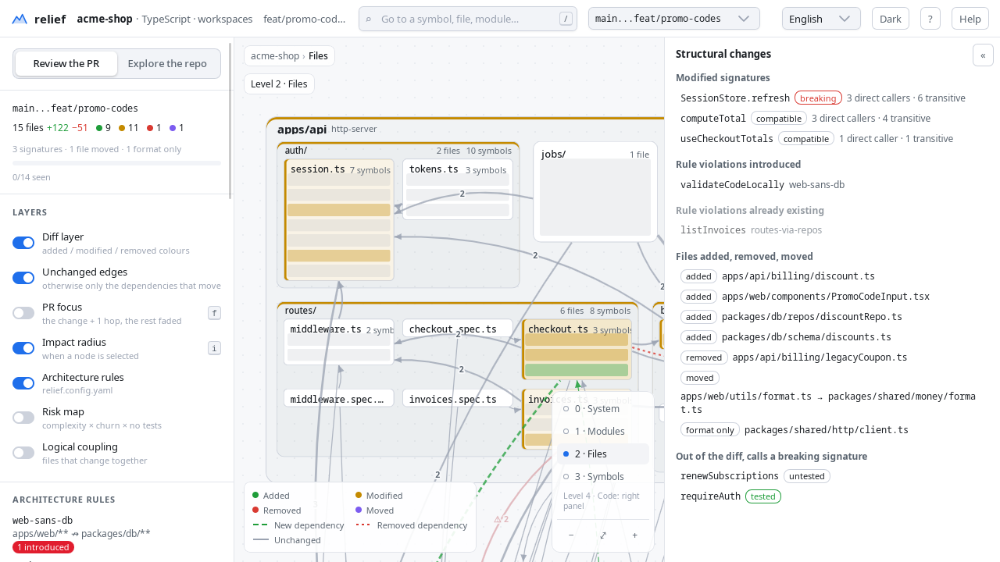

relief is a desktop app that shows a zoomable map of your git repository, locally, in its own window. You start it from a terminal with the `relief` command.

## Install

relief ships in three formats for Linux. `just package` builds the `.deb` and the AppImage in `target/release/bundle/`; the Arch package is then built from the `.deb`.

- **Debian, Ubuntu**: the `.deb` package, which declares its dependency on `libwebkit2gtk-4.1-0`.

  ```sh
  sudo apt install ./relief_0.1.0_amd64.deb
  ```

- **Arch, CachyOS, Manjaro**: a native package, built by the `PKGBUILD` of `packaging/arch/` from the `.deb` (it depends on `webkit2gtk-4.1` and `gtk3`).

  ```sh
  cd packaging/arch && makepkg -f
  sudo pacman -U relief-0.1.0-1-x86_64.pkg.tar.zst
  ```

- **Any other distribution**: the AppImage, a single executable file that carries its libraries. The host only needs a display server (X11 or Wayland), the OpenGL drivers and FUSE to mount the image (without FUSE, run it with `APPIMAGE_EXTRACT_AND_RUN=1`).

  ```sh
  chmod +x relief_0.1.0_amd64.AppImage
  ./relief_0.1.0_amd64.AppImage .
  ```

The binary is linked against the glibc of the machine that built it: the `.deb` and the AppImage only run on a distribution whose glibc is at least as recent (for the packages of this repository, built on CachyOS, glibc 2.44). For an older distribution, build relief on it or from source.

If `relief` still shows subcommands (`show`, `diff`, `serve`), it is an old version installed by `cargo install` in `~/.cargo/bin`, which comes before `/usr/bin` in the `PATH`: `which -a relief` lists them, `cargo uninstall relief-cli` removes the old one.

In all three cases the command is `relief` (the AppImage runs by its file name, or renamed to `relief`) and this documentation is embedded: the Documentation entry of the Settings menu works offline.

## Requirements to build

- Rust (cargo), to build relief;
- Node.js and npm, to build the interface and this documentation;
- git, and a repository to open;
- on Linux, `webkit2gtk-4.1` (and `libsoup-3.0`, `gtk+-3.0`): the relief window is built on it, so it must be installed at run time (the `-dev` packages are needed to build).

## From source

relief is installed from a clone of its repository. The interface and this documentation are embedded in the binary at compile time: build them first, then copy the documentation into the interface.

```sh
git clone <relief-repository-url> && cd relief
npm --prefix src/ui install && npm --prefix src/ui run build
npm --prefix docs/user install && npm --prefix docs/user run build
cp -r docs/user/dist src/ui/dist/relief/browser/docs
cargo install --path src/interfaces/relief-desktop --features custom-protocol
```

The `relief` binary is then in `~/.cargo/bin`. With [`just`](https://github.com/casey/just), `just build` builds the documentation and the interface, copies the documentation, then builds `target/release/relief`.

## Open a repository

Go to a git repository and run:

```sh
relief [path] [range]
```

The relief window opens on the current repository. Nothing is written to your repository.

- With no argument, the range shown goes from `HEAD` to the working tree. For another range (`range`), pass it: `relief . main...my-branch` (against the merge-base) or `relief . A..B`.
- The first argument (`path`) is the folder to analyse: `relief ~/code/my-repo`.

## First look

The home screen shows the name and tagline of relief, and the window carries the repository name; the "Help" link opens this documentation in a second window, offline, in the language of the interface.


## Read the map

The map is nested: systems, modules, files, symbols.

- **Wheel**: zooms around the cursor; the `+` and `−` buttons zoom around the centre, `⤢` fits everything. A box opens by itself once it is big enough.
- **Double-click** a box: frames it and opens it.
- **Drag**: pans the map.
- **Single click**: no effect for now.
- The buttons at the bottom right (or keys `0` to `3`) choose the level shown.



Details are in [The map](../map/).

## Where relief keeps its data

relief keeps its data in a `.relief/` folder at the root of your repository. It ignores itself (its `.gitignore` holds `*`), so `git status` stays clean, and relief never analyses its content. `cache/` holds the index and is disposable: deleting it is safe, it is rebuilt. `state/` holds what relief remembers for you (for example what you already reviewed): keep it. For a bare repository or a read-only folder, relief falls back to `~/.cache/relief/<repo-id>/` (or `$XDG_CACHE_HOME/relief/<repo-id>/`). `RELIEF_CACHE_DIR` picks another folder.
