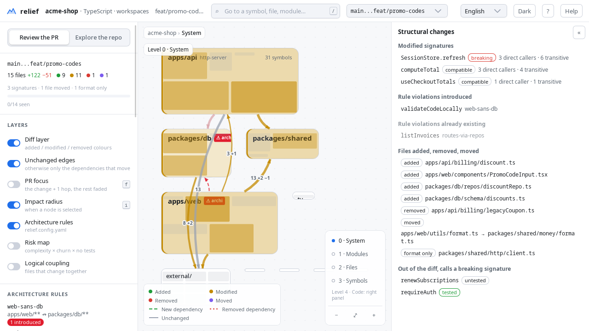
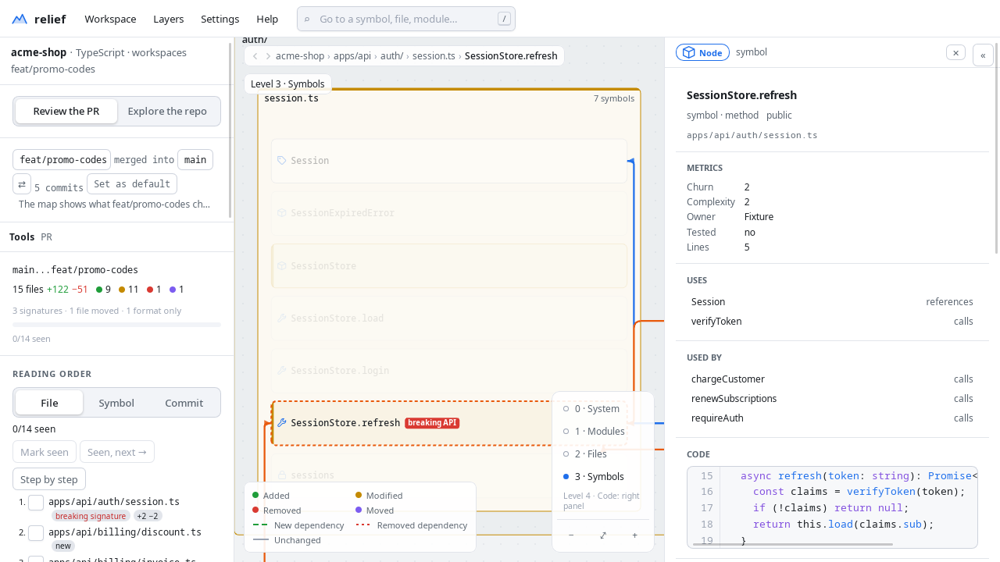

The repository as a zoomable map.

## The screen

- **Top bar**: on the left, the menu bar **Workspace**, **Settings** and **Help** (from the keyboard: `Alt` + `W`, `S` or `H`, then the arrows, `Enter` to pick, `Esc` to close); then the search field. The **Settings** menu holds the theme (Light, Dark or System, which follows the system setting), the language (English or Français), the **Shortcuts** (also on the `?` key) and **Reload**; the **Help** menu opens the **Documentation**. The **Workspace** menu offers "Open a repository…" and "Open a workspace…" (the workspace folder, with its `.relief.json` file); its other multi-repository entries are greyed out, with a tooltip, until they arrive. A menu closes on `Esc` or a click outside.
- **Three columns**: the left sidebar, the map in the middle, and the right panel.
- **Left sidebar**: at the top, the repository name, followed by the languages read and the detector used (for example "TypeScript · workspaces"; hidden in a narrow window), and the current branch. Then the **Review the PR / Explore the repo** switch; in review, the comparison (commit range) shows below it. Then the **Tools** block, specific to the mode: the PR card, reading order, signals and rules in review; entry points, hotspots and rules in exploration. Last, the **Display** block, shared by both modes: the layers that make sense in the mode (diff and focus in review, risk and logical coupling in exploration), "Hide external dependencies" and the layout.
- **Resize**: drag the handle on a column's edge. relief remembers the width for next time. Double-click the handle to restore the default width.
- **Widen**: the button at the top of the right panel makes it larger for easier reading; click it again to restore its width.
- Language and theme switch immediately, without reloading the page, and are remembered.
- If the API answers with an error, its message is shown instead of the map. A repository with no commits says so too.

## Levels: system, modules, files, symbols

The map is nested: systems (packages, services, external dependencies when shown) contain modules, which contain files, which contain symbols. Each box shows its name, its kind and its counters.

- **Semantic zoom**: a box opens by itself once it is large enough on screen, and then shows its children. A box that is still closed hints at its children as faint outlines. When you zoom out, the title of an open box shrinks with it; once it would be too small to read, it moves into a tab sitting on the box's top border. A closed box too small for its name shows none. The name stays visible on hover.
- **Four levels**: `0 · System`, `1 · Modules`, `2 · Files`, `3 · Symbols`. Pick them with the buttons at the bottom right of the map or with the `0` to `3` keys. The current level is shown at the top left of the map.
- Level 4, the code, is shown in the right panel.
- **Repos level (workspace)**: when you open a workspace, the map gains a level `0 · Repos` above the others, which become `1 · System`, `2 · Modules`, `3 · Files` and `4 · Symbols` (use the buttons: keys `0` to `3` stay those of the four levels of a single repository). Each repository is a box with its name, its branch and its labels (`front`, `back`…); a double click on it zooms into the repository and opens its systems. The diff of each repository, computed on its own range (its source against its destination, set in the workspace file), shows on the same map, with the reading order and the impact on the whole. A single repository has no such level. In a workspace, the architecture rules (`relief.config.yaml`) are not evaluated yet.

## Zoom and navigation

- **Pan**: drag the map.
- **Zoom**: the mouse wheel zooms around the pointer; the `+` and `−` buttons zoom around the centre.
- **Fit everything**: the `⤢` button (or the `0` key) frames the whole map.
- **Dive in**: double-click a box to frame and open it.
- Framing changes are animated. Boxes outside the screen are not drawn, which keeps the map smooth on a large repository.

## Search and find your way

- **Search**: `/` puts the cursor in the search field at the top. Type part of a symbol, file or module name (`refresh`), or a path (`/checkout`). The best matches come first: the exact name, then names that start with the query, then names that contain it. Each result shows its type and path.
- **Pick**: the up and down arrows move through the results, Enter (or a click) selects one. The map then frames the symbol's file and opens it down to the symbol. Escape closes the list and clears the field.
- While the cursor is in the field, typed keys trigger no shortcut.
- Search by HTTP route (`POST /checkout`) is not available yet: search for the file's path instead.
- **Breadcrumbs**: at the top left of the map, the path of the selected node, for example `acme-shop › apps/api › auth/ › session.ts › SessionStore.refresh`. Click an ancestor to select and frame it. With nothing selected, the breadcrumbs show the current level.
- **Back / forward**: each selection (node, edge, search result, panel link) is a step of a history. The two arrows left of the breadcrumbs, `Alt` + `←` / `→` or the mouse side buttons go back or forward one step, selection and framing included. Panning or zooming by hand adds no step; changing the range clears the history.
- **Escape**, outside the search field: first deselects the node, then goes up one level per press, until everything is shown.

## Keyboard shortcuts

The `?` key (or Settings › Shortcuts) opens the shortcut list; Escape closes it.

| Key               | Action                                                             |
| ----------------- | ------------------------------------------------------------------ |
| `0` to `3`        | Zoom level: system, modules, files, symbols                        |
| `/`               | Search                                                             |
| `?`               | Show the shortcut help                                             |
| `Alt` + `←` / `→` | Previous / next step of the history                                |
| `Esc`             | Close the help, deselect, then go up a level, then show everything |

## Inspecting a node

The right panel is an inspector. Its header says what it shows: a **Node** badge (with its kind), **Edge** (with its link kind) or **Overview** when nothing is selected, and a ✕ button that deselects. In exploration, with nothing selected, it asks you to click a node or an edge.

Selecting a node (click, search then Enter, breadcrumbs) opens it in the right panel:

- **Identity**: name, kind, visibility, and the path of its file or folder.
- **Children**: for a system, module or file, its children, in source order.
- **Uses** and **Used by**: the fine links to and from this node, each with its kind (call, import, reference…). Clicking a link selects the linked node.
- **Depends on** and **Used by** (edges): the map arrows leaving or reaching this node, at the shown level. Clicking a row selects the edge.
- **Code**: the code of the file or symbol, with line numbers and light syntax highlighting.

The panel only shows facts taken from git and the graph: no text is generated.

On the map, the edges of the selected node stand out: outgoing ones in the accent colour, incoming ones in the impact colour, thicker; the other edges fade, and so do the nodes that are not its direct neighbours. The edges inside the selected node, between two of its children, are hidden: only its dependencies to the outside remain. A selected edge stays the only sharp one, with its two ends. `Esc` or a click on empty space restores everything.

## Reading dependencies

The arrows between boxes are the code's dependencies: imports, calls, component renders, references and package dependencies.

- **Aggregated at the visible level**: each fine link (for example one function calling another) is attached to the first visible box that contains each of its ends. At the System level, all links from `apps/web` to `packages/db` form a single arrow. Links inside one box, or between a box and its own contents, are not drawn.
- **Direction and weight**: the arrow goes from the box that depends to the box it depends on. The more links it carries, the thicker it is. At rest an arrow carries no text: colour and dash already say added or removed. A label appears on the hovered arrow, on the arrows of the selected node and on the selected arrow; it stays on an arrow that breaks a rule (`⚠ n`) and on the count badge of a merged arrow. The label gives the number of links (from two up) and, in review, what the PR changes: `+n` links added, `−n` links removed, "new" for a new dependency of a single link, "moved". An arrow too short on screen (under 60 px) carries no label: zoom in to see it. The same text stays in the tooltip and the inspector.
- **Bundles**: from three arrows entering the same box by the same side (or leaving it), they converge on a port in the middle of that side and share a trunk a few tens of units long. The trunk carries a badge with the number of arrows (and `+n` new ones in review); its colour is that of the majority status, with an edge when statuses are mixed. A hovered or selected arrow is drawn alone, whole, over the bundle; hovering a branch picks the arrow, hovering the trunk picks the bundle. Clicking the trunk opens the bundle in the inspector, which lists its arrows; clicking one opens it.
- **Tooltip**: on hover, an arrow shows its two ends, its number of links and their kinds, for example "apps/web → packages/db · 2 links (calls, imports)".
- **Details**: clicking an arrow (or its number) opens it in the inspector: its two ends as buttons (a click selects that node), chips (kind, resolved or heuristic precision, number of links, "added by the PR"), then the list of fine links, each with its kind. Clicking a link selects the symbol it starts from.
- **Routes along the corridors**: an arrow drawn alone no longer crosses the boxes it does not link. It follows the corridors between the boxes, in horizontal and vertical segments with rounded corners, from the border of one box to the border of the other (it may cross the boxes that contain its ends). Routes are computed at rest, along with the layout; while you zoom they are just scaled. When no corridor leads to a box, the arrow keeps its direct curve. The arrows of a bundle keep their branches.
- **Usages in the code**: below the links, an edge's inspector lists where the source file uses what it imports, not just the import. Usages are grouped by file, then by imported symbol, with their count; a default or `* as` import is grouped under its local name (`db` for `import * as db`, and `db.findUser()` counts as a usage). Each row gives the line number, the code line with the symbol highlighted, and the enclosing function; a click opens the code at that line. A removed edge is read on the base side. The list stops at 200 usages ("and N more"). An import that is never used says so. For a language without this analysis (Python for now), the inspector says it is not supported.
- **External dependencies**: the **Hide external dependencies** switch, in the **Layers** section, removes the third-party packages (the external dependencies group) and the edges leading to them from the map. It is on by default, and the choice is remembered.
- **Edge labels: always**: the switch in the **Display** section writes the label on every arrow, not only the hovered or selected ones. It is off by default, and the choice is remembered.
- **Edges at the Symbols level**: even when a file shows its symbols, the arrows between two files stay one arrow per pair of files, and its number tells how many links it holds. Select a file or a symbol to see its arrows go down to the symbols; `Esc` folds them back. The inspector of an arrow still lists every symbol-to-symbol link.
- **Unchanged edges**: the switch in the **Layers** section of the left sidebar hides or shows the arrows. In review, it keeps only the dependencies the diff touches.

## Risk map

The **Risk map** layer, in the Layers section, colours each node by its risk (complexity × churn, doubled without a test, see [Hotspots](../explore/#hotspots-where-to-look-first)): four shades, from the lightest to the strongest. A box takes the shade of its riskiest element. It is off by default.

## Large repositories

Beyond about 2,000 nodes, relief does not send the whole graph to the screen at once: it opens the first levels while they fit, and leaves the other containers closed, with the number of their children. The dependencies between closed containers stay visible, aggregated.

- **Zooming** into a closed container loads its content: an indicator shows in the box while it loads.
- **Searching** (`/`) queries the whole repository, not only what is displayed: picking a result loads the containers that hold it and frames the map on it.

In review, relief only sends what the review needs: the changed nodes, their direct neighbours and their ancestors; the other containers stay closed. The map starts at the Files level, so the changed files are visible without zooming.

On a map that shows many edges at once (over 500 on screen), relief only draws in full the ones that matter: changed, breaking a rule, selected or on the impact radius. The others are drawn as thin lines, without arrow or label; clicking one of those lines still selects the edge and opens its inspector. Edges with no part on screen are not drawn.

## Layout

The **Layout** section, in the left sidebar, chooses how boxes are arranged inside their container.

- **Fewer crossings** (default): relief reorders the children of each box so that arrows cross less at the Modules, Files and Symbols levels. The grid and the box sizes stay the same; only the order changes. The computation is capped at 300 ms: on a large repository, relief keeps the best order found in that time. The first top-level box stays in place.
- **Raw grid**: boxes are arranged in alphabetical order.
- Switching layouts moves the boxes with an animation. The choice is remembered for the next visit.

## Labelling the repositories of a workspace

In a workspace, the header of the left sidebar lists each repository with its branch and its labels. The **+** button of a repository opens the available labels (`front`, `back`, `ops`, `tools`, plus the ones declared in the `labels` field of the workspace file): a click adds or removes a label. The choice is saved in the `<name>.relief.json` file and the map shows it at once on the repository box.

To add a label to the list, declare it in the top-level `labels` field of the workspace file, next to `repos`.

In the **Display** section, **Filter by label** hides the repositories that carry none of the chosen labels, with everything they contain and the arrows leading to them. A repository without labels is hidden as soon as a label is chosen; turn every label off to see everything again. The filter only appears in a workspace and is not saved.
