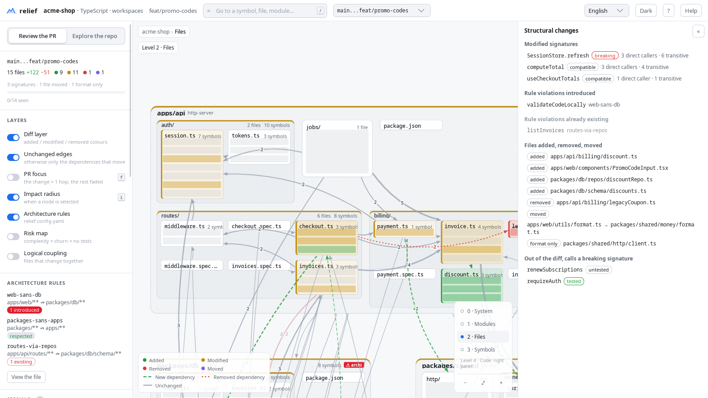
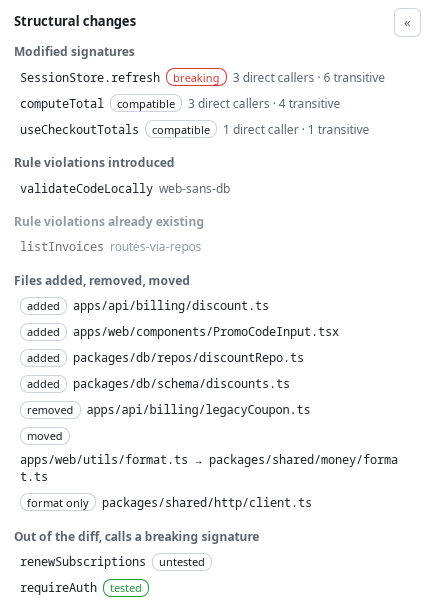
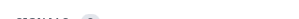
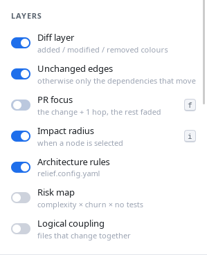
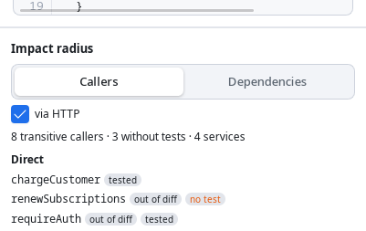
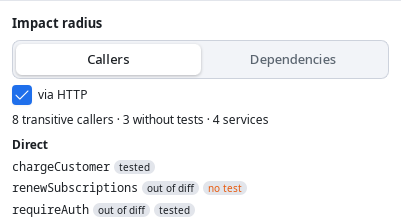
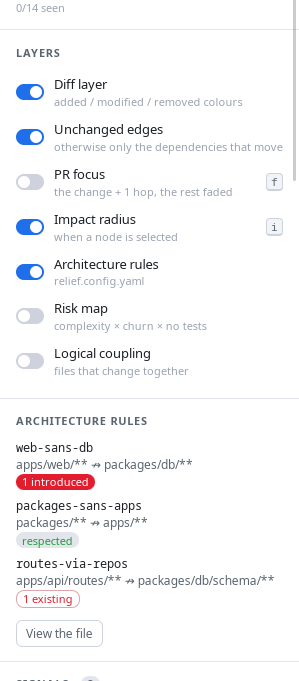
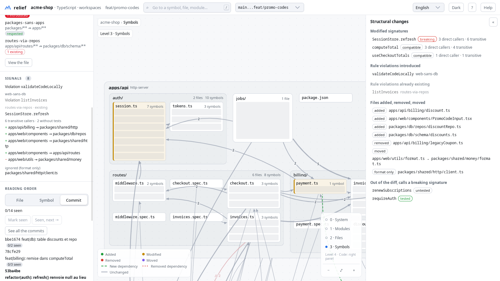

Overlay the diff on the map: what is added, modified, removed or moved, and the dependencies that appear or disappear.

## Review the PR

The **Review the PR / Explore the repo** switch, at the top of the left sidebar, picks the mode: review or exploration. On, the map carries the diff of the chosen range. Off, it is the repository map alone, without any diff mark.

## Pick a commit range

In the top bar, the **base ··· head ⇄** control picks what is compared, followed by the number of commits in the range. Each side (keys `b` and `h`) opens a list with a filter field, shortcuts (base: `main`, `HEAD~1`, the latest tag; head: **Working tree**, `HEAD`) and three tabs, **Branches**, **Tags** and **Commits**. The Commits tab shows the history of head, with the commits of the range highlighted and the other end marked BASE or HEAD. Arrows, `Enter`, `Tab` (next tab) and `Esc` work from the keyboard.

- **`···` or `··`**: `base...head` (default) compares from the common ancestor, like a PR; a click switches to `base..head`, the direct diff between the two.
- **⇄** swaps base and head. It is disabled when head is the working tree, which base does not offer.

Picking a side reloads the diff.

- **In the URL**: the range is kept in the `?range=` parameter. A link to `/?range=main...feat/promo-codes` reopens the same review.
- **At launch**: `relief . main...feat/promo-codes` opens that range directly. Without a range, the map shows `HEAD` up to the working tree.
- For now, the selector only offers pairs of branches: neither the working tree nor the index.
- The diff follows the chosen range; the map itself keeps the repository as relief opened it.

## Review changes in progress

Without a range (`relief .`), relief compares `HEAD` with the working tree: that is how to review what an AI agent just wrote, before committing. When the range touches the working tree or the index, the **Reload** button in the top bar reads the repository again, and relief also reloads by itself when its window gets the focus back. The selection, the zoom level and the "seen" state are kept; a node that disappeared is simply deselected. Ranges between two commits do not change and do not reload.

## Read the diff layer

Each box (system, module, file, symbol) carries the state of what it contains.

| Colour              | Meaning                                         |
| ------------------- | ----------------------------------------------- |
| Green               | **Added**                                       |
| Amber               | **Modified**                                    |
| Red, dashed outline | **Removed**                                     |
| Violet              | **Moved**; the old location stays drawn, dashed |

- **Intensity**: the bigger a change, the stronger the colour. Three degrees: up to 5 lines, up to 20 lines, beyond.
- **Tinted containers**: a module or a system takes the tint of its descendants, so you can spot where the diff is from afar, before zooming in.
- **Moved**: a moved file (renamed, for example `apps/web/utils/format.ts` to `packages/shared/money/format.ts`) shows once as moved, with its old location dashed. It is not counted as an addition plus a removal.
- **Format only**: a file whose formatting alone changed (no symbol or link changed) carries the "format only" badge: no need to read it.

### Signature badges

A file or symbol whose public signature changes carries a badge:

- **breaking API**: a change incompatible for callers (removed parameter, different return type...).
- **API**: a change to the public signature that stays compatible with existing callers.
- **internal sig.**: a signature change on an internal, non-exported symbol.
- **format only**: see above.

### Dependencies

- **New**: green, animated.
- **Removed**: red, dashed.
- **Unchanged**: grey. The "Unchanged edges" layer hides them to keep only the dependencies the diff touches.

New and vanished couplings are shown as relief's core reports them: a new or removed arrow. The [Signals](#signals) section lists them between modules.

Calls from the front end to the API are dependencies too: a call through `fetch` or a wrapper (`httpPost("/checkout", ...)`) with a literal path is linked to the server route declared by `app.<verb>` or `router.<verb>`. The `:id` and `${...}` parameters act as wildcards. When the verb is unknown, the edge is marked heuristic. A `fetch` on a URL held in a variable produces no edge.

### The legend

A legend at the bottom left of the map recalls the colours: Added, Modified, Removed, Moved, New dependency, Removed dependency, Unchanged.

## The PR card

Below the mode switch, **The PR** summarises the range:

- the range under review (`main...feat/promo-codes`);

- the number of files touched and the lines added (+) and removed (−);
- the number of symbols added, modified, removed and moved, each after a dot of its colour;
- the number of changed signatures, moved files and "format only" files;
- a progress bar of the review ("0/14 seen").

## Overview: structural changes

With nothing selected, the right panel lists what the PR changes, computed from the graph by relief's core (no AI summary):

- **Modified signatures**: each symbol whose signature changes, with a **breaking** or **compatible** badge, and its number of direct and transitive callers (for example "3 direct callers · 6 transitive").
- **Rule violations introduced**: coming soon. The group does not show until architecture rules are checked during review.
- **Files added, removed, moved**: one file per row, with its status (added, removed, moved, format only). A moved file shows its old and new path.
- **Out of the diff, calls a breaking signature**: symbols the PR does not touch but which directly call a breaking signature, with a **tested** or **no test** badge. On acme-shop, `requireAuth` (tested) and `renewSubscriptions` (untested) call `SessionStore.refresh`.

Clicking a row selects its node and frames it on the map.

## Signals

In the left sidebar, the **Signals** section counts and lists:

- breaking signatures, with "N transitive callers · M without tests";
- new couplings between modules (+) and removed ones (−), for example `apps/web/components → packages/db/repos`. HTTP edges count too: on acme-shop, `apps/web/components → apps/api/routes` is added, making 4 new couplings;
- files ignored because only their formatting changes;
- rule violations introduced: coming soon.

Clicking a signature or an ignored file selects it.

## Layers

The **Layers** section of the left sidebar groups the display switches, each with its shortcut:

- **Diff layer**: shows or hides the colours, badges, counters and the added or removed edges. Removed nodes stay drawn, without a mark.
- **Unchanged edges**: hides or shows the dependencies the diff does not touch.
- **PR focus** (key `f`): only the changed symbols and their direct neighbours (what they call and what calls them) stay sharp, with the boxes that hold them; the rest is faded. On acme-shop, `CheckoutPage` stays sharp, `LoginPage` (two hops from the nearest change) is faded.
- **Impact radius** (key `i`): see [Impact radius](#impact-radius).

## Read the code

In "Review the PR" mode, selecting a changed symbol or file (click it on the map, or press `/` to search) opens its **structural diff** in the right panel:

- **Unified diff**: the removed (−) and added (+) lines between the base and the head of the chosen range, with the file's line numbers on both sides. An added symbol only has added lines, a removed symbol only removed lines. For a moved file, the base is read at its old location.
- **One block per symbol**: for a file, each symbol gets its own block, with its status (added, modified, removed, moved).
- **Format only**: for a file where only the formatting changed, the text diff is hidden ("58 text diff lines hidden: only the formatting changes"). The **Show the text diff anyway** button shows it.
- **Signature**: when the signature changes, the panel shows the before and after, the **breaking** or **compatible** badge, the reason (for example "Return type widened (null possible)") and whether the symbol is part of the **public API** or **internal**.
- **expand** / **collapse**: the header button widens the right panel to read long lines.

## Impact radius

Select a node (click it, or search with `/`): relief computes everything that depends on it, directly or step by step. On the map, reached nodes get a dashed orange outline, the rest is dimmed and the edges of the path turn orange. A closed box that contains reached nodes shows "⚡ n".

The **Impact radius** layer in the left sidebar (key `i`) turns this highlighting on or off.

In the node panel, the impact section gives:

- the direction: **Callers** (what depends on this node) or **Dependencies** (what it depends on);
- the **via HTTP** box, checked by default and remembered: a front-end call to an API route counts as a call. Unchecked, the impact stops at the boundary between services;
- the count, the number of nodes without tests and the number of services reached;
- the list by depth ("Direct", "At 2 hops"…), each row marked **via HTTP**, **out of diff** (the range does not change the node) and **tested** or **no test**.

On acme-shop, `SessionStore.refresh` has 8 transitive callers via HTTP, 6 without.

## Reading order

The **Reading order** section lists the changes in the order to read them: a file comes after the files it depends on, so you never read a call before what it calls. Ties follow the path. Files that only change by their formatting and the old locations of moved files are left out.

Three modes:

- **File** (default): one changed file per row;
- **Symbol**: one changed function, class or type per row;
- **Commit**: the commits of the range, oldest first (see below).

Each row is numbered and says why to read it: breaking or changed signature, new, removed, moved, and the number of lines added and removed. On acme-shop, the PR has 14 files, or 22 symbols.

## Replay commit by commit

In **Commit** mode, each row is a commit of the range: short SHA, message, "x/y seen" and, if any, the number of files without a structural change (formatting only). The files of the selected commit show below it, in reading order.

Click a commit to replay it: the map colors only its changes (nodes and edges) and frames its files. The diff panel then shows what that commit changed, even when several commits touch a file. Click the commit again, or **See all the commits**, to go back to the whole range. `n` and `p` move from commit to commit.

"Seen" is the same as in File and Symbol modes: what you mark in a commit is seen everywhere.

## Mark as seen

Tick a row's box, or use **Mark seen** and **Seen, next →** in the panel. With the keyboard:

- `n` selects the next unseen entry, `p` the previous one;
- `v` marks the selected entry seen (or unmarks it).

"Seen" is tracked by symbol. Marking a file marks all its changed symbols, and a file is seen when all its changed symbols are. If the file also changes outside its symbols (an import, for example), that part is one more entry to mark. So, in Symbol mode, marking `computeTotal` does not mark the whole of `invoice.ts`.

The progress ("1/14 seen") shows at the top of the section. On the map, seen nodes are dimmed and boxes show "x/y seen".

The progress is saved per repository and per range in `.relief/state/review/` at the root of the repository (one file per range): it survives closing relief. For a bare or read-only repository, it goes to `~/.cache/relief/`. If no folder is available, relief says so and keeps the progress in memory until it closes.
