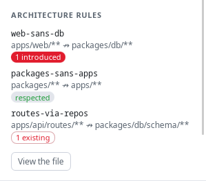

Declare and check allowed dependencies.

## The relief.config.yaml file

Rules are declared in `relief.config.yaml`, at the root of the repository. Here is acme-shop's:

```yaml
# relief.config.yaml
rules:
  - id: web-sans-db
    description: 'le front ne parle jamais directement à la base'
    from: apps/web/**
    deny: packages/db/**
  - id: packages-sans-apps
    description: "une lib partagée ne dépend jamais d'une app"
    from: packages/**
    deny: apps/**
  - id: routes-via-repos
    description: 'les routes passent par les repos, pas par le schéma'
    from: apps/api/routes/**
    deny: packages/db/schema/**
```

Each rule has:

- `id`: a short name, unique in the file;
- `description`: the sentence shown with a violation;
- `from`: the files concerned (a path glob);
- `deny`: the files they must not depend on (a path glob);
- `kinds` (optional): the kinds of dependencies checked, by default `imports`, `calls`, `references` and `renders`. The others (`http`, `depends_on`, `extends`, `implements`) are checked only when `kinds` names them.

In a glob, `*` stands for one path segment and `**` for any folders.

The same file can list files to ignore, which then no longer show on the map:

```yaml
exclude:
  - '**/generated/**'
  - '**/*.min.js'
```

The threshold of the [logical coupling](../explore/#logical-coupling) is also set in this file, under `co_change: { min_commits: N }`.

### Where relief reads the file

relief reads `relief.config.yaml` in the head commit of the reviewed range: the rules of a PR apply to that PR, even when it changes the file. Without a file, there are simply no rules.

If the file is invalid (malformed YAML, duplicate `id`, wrong glob), relief reports it with the line and the column at fault.

### relief.config.yaml or .relief/

- `relief.config.yaml` is **versioned**: committed with the code, it describes the intended architecture and is the same for the whole team.
- `.relief/` is **local**: relief keeps its cache and the review progress there. git ignores it and it belongs to each working copy.

## Violations

A dependency from a `from` file to a `deny` file is a violation. relief tells two kinds apart:

- **introduced**: the dependency did not exist in the base of the range, the PR adds it;
- **existing**: it already existed before the PR. That is debt, shown more discreetly.

An import followed by a call to the same file counts as a single violation.

### On the map

The **Architecture rules** section of the left sidebar lists each rule (`from ↛ deny`) with its outcome: "1 introduced", "1 existing" or "respected". On acme-shop, `web-sans-db` has 1 introduced violation, `packages-sans-apps` is respected and `routes-via-repos` has 1 existing violation.



- Click a rule to select its faulty edge: the edge panel shows the rule (description, paths, globs) and says whether the violation is introduced by this range or already existed on the base.
- **View the file** shows the `relief.config.yaml` relief read, in the panel, without opening anything outside.
- On the map, an introduced violation is an animated red edge marked "⚠ n", an existing violation a discreet red edge. The nodes concerned carry the "⚠ archi" badge (in review, for introduced violations only).
- The **Architecture rules** layer, in the Layers menu, shows or hides these marks.
- Introduced violations count in the Signals and the overview; existing ones are listed apart.
