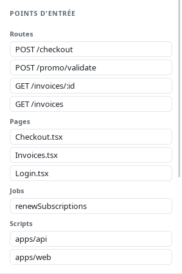
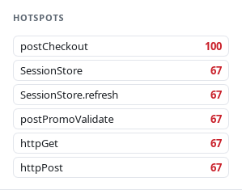

Comprendre un dépôt inconnu.

## Le mode exploration

Le bouton **Explorer le repo**, en haut de la barre de gauche, bascule de la relecture à l'exploration ; **Relire la PR** fait le chemin inverse. En exploration, la carte montre le dépôt tel qu'il est au commit de tête, sans diff : ni couleurs de changement, ni fichiers supprimés ou anciens emplacements, ni arêtes retirées. La carte, les panneaux et la recherche restent les mêmes.

## Points d'entrée

La section **Points d'entrée** de la barre de gauche liste par où le code commence, groupé par sorte :

- **Routes** : les routes HTTP déclarées (`app.get("/invoices", …)`) ;
- **Pages** : les composants sous un dossier `pages/` ;
- **Jobs** : les fonctions exportées sous un dossier `jobs/` ;
- **Scripts** : les packages qui déclarent des `scripts` dans leur `package.json` (`start`, `dev`, `test`…).

Clique sur un point d'entrée pour le sélectionner sur la carte. Sur acme-shop, relief trouve 4 routes, 3 pages (Checkout, Invoices, Login) le job `renewSubscriptions`, et les scripts de `@acme/api` et `@acme/web`.

En dessous, la **Vue d'ensemble** chiffre le dépôt : le detector utilisé, le nombre de packages, de dépendances externes, de fichiers et de symboles, et les liens par type.



## Suivre un flux

En exploration, clique sur un point d'entrée : relief le sélectionne et trace tout ce dont il dépend, de proche en proche, jusqu'aux dépendances externes (paquets npm comme `stripe-sdk`). C'est le [rayon d'impact](../review/#rayon-dimpact) dans le sens **Dépendances** : les nœuds atteints sont surlignés sur la carte, le reste est estompé, et le panneau liste les nœuds par profondeur. Un paquet externe compte un saut de plus que le symbole dont le fichier l'importe.

Sur acme-shop, `POST /checkout` mène à `computeTotal` et `chargeCustomer` (directs), puis jusqu'à `stripe-sdk`.

## Hotspots : où regarder en premier

En exploration, la section **Hotspots** liste les 6 symboles les plus risqués du dépôt. Clique sur l'un d'eux pour le sélectionner. Le risque combine trois mesures :

- **churn** : le nombre de commits des 90 derniers jours qui touchent le symbole (ou le fichier), en comptant depuis la date du commit affiché ;
- **complexité** : la complexité cyclomatique (chaque `if`, boucle, `case`, `catch`, ternaire, `&&`, `||` ou `??` ajoute un chemin) ;
- **tests** : un symbole qu'aucun test n'atteint compte double.

Le risque vaut complexité × churn × (2 sans test), ramené entre 0 et 1 par le symbole le plus risqué. Un symbole qui n'a pas bougé dans la période n'est pas un hotspot.

Le churn d'un fichier est exact. Celui d'un symbole est une approximation : relief compare les lignes touchées par chaque commit à la place actuelle du symbole, sans suivre les lignes déplacées depuis. Un fichier compte comme testé dès qu'un test atteint l'un de ses symboles.

Le panneau d'un nœud affiche ses **Métriques** : churn, complexité, auteur majoritaire sur la période et s'il est testé. Le calque [Carte de risque](../map/#carte-de-risque) colore toute la carte selon ce risque.

Ces mesures dépendent de l'historique : relief les calcule à part et les garde dans `.relief/cache/`, sans changer la carte elle-même.



## Couplage logique

Certains fichiers changent souvent ensemble sans dépendre l'un de l'autre dans le code : un fichier et sa doc, un schéma et ses migrations, deux services qui partagent un format. Le calque **Couplage logique**, dans le menu Calques, les relie par des arêtes pointillées d'une autre couleur.

relief les tire de l'historique git, pas du code : ce calque marche donc sur **n'importe quel dépôt**, même sans adapter de langage (Markdown, YAML, shell…).

- Deux fichiers sont couplés quand au moins 2 commits les modifient ensemble dans les 90 jours qui précèdent le commit affiché.
- Les commits qui touchent plus de 30 fichiers (renommages, reformatages de masse) sont ignorés : ils relieraient tout à tout.
- Pour chaque paire, relief calcule aussi la **confiance** : la part des commits du fichier le plus modifié qui touchent aussi l'autre.

Le seuil se règle dans `relief.config.yaml` :

```yaml
co_change:
  min_commits: 3
```

Comme les hotspots, ce calcul est rangé dans `.relief/cache/` et ne change pas la carte elle-même.

## Chercher un symbole

À venir : cette fonctionnalité n'existe pas encore.

## Impact d'un changement

À venir : cette fonctionnalité n'existe pas encore.
