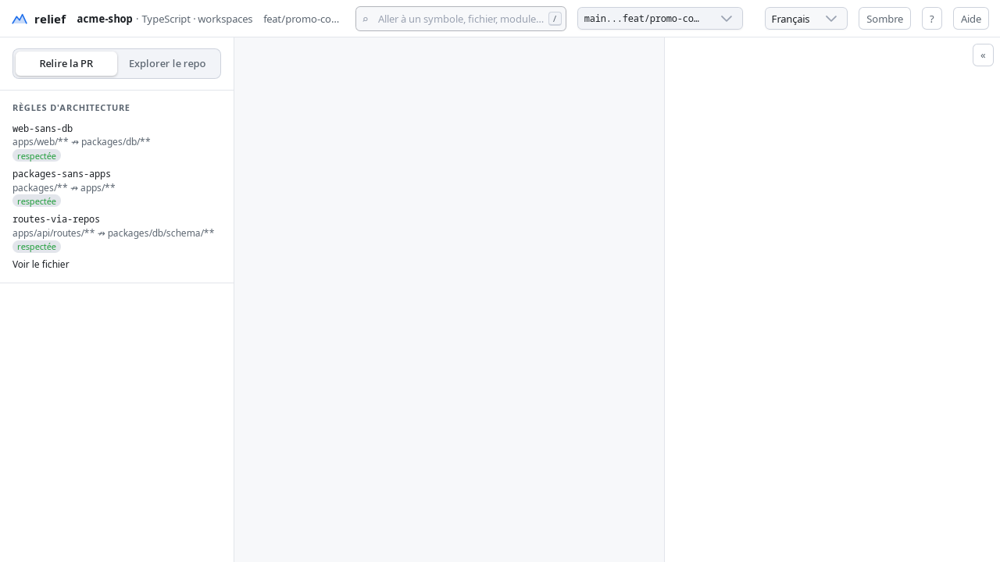
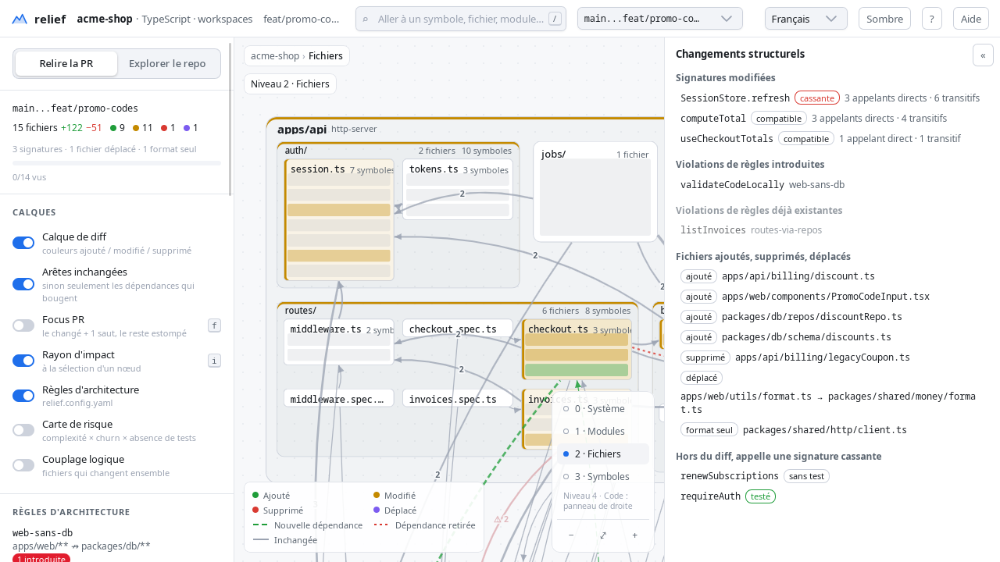

relief est une application de bureau qui affiche une carte zoomable de votre dépôt git, en local, dans sa propre fenêtre. Elle se lance depuis un terminal avec la commande `relief`.

## Installer

### En une commande, sans droits admin

Depuis un clone du dépôt, une seule commande construit relief à partir de la branche courante (modifications non commitées comprises) et l'installe dans votre dossier utilisateur, sans `sudo`. Elle détecte l'OS et n'a besoin que de Docker sous Linux et Windows.

```sh
./install.sh
```

Sous Windows, depuis PowerShell : `.\install.ps1`.

- **Linux** : build dans un conteneur Docker (Ubuntu 22.04, donc compatible avec toute distribution dont la glibc est au moins 2.35), puis installation dans `~/.local/share/relief/`, avec la commande `~/.local/bin/relief`, une entrée de menu et son icône. Le premier build prend plusieurs minutes ; les suivants réutilisent les caches cargo et npm (volumes Docker `relief-build-cache` et `relief-build-work`).
- **Windows** : build croisé dans Docker Desktop, puis installation silencieuse pour l'utilisateur seul dans `%LOCALAPPDATA%`. Le build télécharge le CRT MSVC et le SDK Windows sous licence Microsoft : le script la présente et demande votre accord (ou `--accept-msvc-license`).
- **macOS** : Docker ne sait pas construire d'app macOS ; le script construit sur la machine (il faut `cargo`, `node` et les Command Line Tools, et il dit lesquels manquent), puis installe `relief.app` dans `~/Applications/` avec la commande `~/.local/bin/relief`.

`./install.sh --dry-run` affiche ce qui sera fait sans rien construire ; `./install.sh --uninstall` retire tout ce que l'installation a posé. Si `~/.local/bin` n'est pas dans votre `PATH`, le script le signale et donne la ligne à ajouter.

### Paquets

relief se distribue aussi en trois formats pour Linux. `just package` construit le `.deb` et l'AppImage dans `target/release/bundle/` ; le paquet Arch se construit ensuite à partir du `.deb`.

- **Debian, Ubuntu** : le paquet `.deb`, qui déclare sa dépendance à `libwebkit2gtk-4.1-0`.

  ```sh
  sudo apt install ./relief_0.1.0_amd64.deb
  ```

- **Arch, CachyOS, Manjaro** : un paquet natif, construit par le `PKGBUILD` de `packaging/arch/` à partir du `.deb` (il dépend de `webkit2gtk-4.1` et `gtk3`).

  ```sh
  cd packaging/arch && makepkg -f
  sudo pacman -U relief-0.1.0-1-x86_64.pkg.tar.zst
  ```

- **Toute autre distribution** : l'AppImage, un seul fichier exécutable qui embarque ses bibliothèques. L'hôte doit seulement fournir un serveur graphique (X11 ou Wayland), les pilotes OpenGL et FUSE pour monter l'image (sans FUSE, lancer avec `APPIMAGE_EXTRACT_AND_RUN=1`).

  ```sh
  chmod +x relief_0.1.0_amd64.AppImage
  ./relief_0.1.0_amd64.AppImage .
  ```

Le binaire est lié à la glibc de la machine qui l'a construit : le `.deb` et l'AppImage ne tournent que sur une distribution dont la glibc est au moins aussi récente (pour les paquets de ce dépôt, construits sous CachyOS, glibc 2.44). Pour une distribution plus ancienne, construisez relief sur elle ou depuis les sources.

Si `relief` affiche encore des sous-commandes (`show`, `diff`, `serve`), c'est une ancienne version installée par `cargo install` dans `~/.cargo/bin`, qui passe avant `/usr/bin` dans le `PATH` : `which -a relief` les liste, `cargo uninstall relief-cli` retire l'ancienne.

Dans les trois cas, la commande s'appelle `relief` (l'AppImage se lance par son nom de fichier, ou renommée en `relief`) et cette documentation est embarquée : l'entrée Documentation du menu Aide marche sans réseau.

## Prérequis pour compiler

- Rust (cargo), pour compiler relief ;
- Node.js et npm, pour construire l'interface et cette documentation ;
- git, et un dépôt à ouvrir ;
- sous Linux, `webkit2gtk-4.1` (et `libsoup-3.0`, `gtk+-3.0`) : la fenêtre de relief s'appuie dessus, il doit être installé à l'exécution (les paquets `-dev` sont nécessaires pour compiler).

## Depuis les sources

relief s'installe depuis un clone de son dépôt. L'interface et cette documentation sont embarquées dans le binaire à la compilation : construisez-les d'abord, puis copiez la documentation dans l'interface.

```sh
git clone <url-du-depot-relief> && cd relief
npm --prefix src/ui install && npm --prefix src/ui run build
npm --prefix docs/user install && npm --prefix docs/user run build
cp -r docs/user/dist src/ui/dist/relief/browser/docs
cargo install --path src/interfaces/relief-desktop --features custom-protocol
```

Le binaire `relief` est alors dans `~/.cargo/bin`. Avec [`just`](https://github.com/casey/just), `just build` construit la documentation et l'interface, copie la documentation, puis compile `target/release/relief`.

## Ouvrir un dépôt

Placez-vous dans un dépôt git et lancez :

```sh
relief [path] [range]
```

La fenêtre de relief s'ouvre sur le dépôt `path`. Rien n'est écrit dans votre dépôt.

- Sans argument, `relief` n'ouvre aucun dépôt : il affiche l'écran d'accueil, où vous ouvrez un dépôt avec le sélecteur de dossier ou choisissez un dépôt récent (la liste est gardée dans votre dossier de configuration). Pour ouvrir le dossier courant, lancez `relief .`. L'entrée « Ouvrir un espace de travail… » (écran d'accueil et menu **Espace de travail**) ouvre un espace existant depuis son dossier ; « Créer un espace de travail… » en crée un, vide, dans le dossier choisi. Tout le parcours est dans [Espace de travail](../workspace/).
- Sans plage, la plage affichée va de `HEAD` à l'arbre de travail. Pour une autre plage (`range`), donnez-la : `relief . main...ma-branche` (contre le merge-base) ou `relief . A..B`.
- Le premier argument (`path`) est le dossier à analyser : `relief ~/code/mon-depot`.

## Espace de travail

Un espace de travail regroupe plusieurs dépôts (un front, une API, une bibliothèque partagée) pour les lire ensemble ; le parcours complet (créer, ajouter, étiqueter, comparer) est dans [Espace de travail](../workspace/). Voici son format de fichier. C'est un dossier de votre choix qui contient :

- `<nom>.relief.json`, la configuration, que vous pouvez versionner ou écrire à la main ;
- `.relief/`, les données locales de l'espace (cache, état de relecture), au même format que le `.relief/` d'un dépôt.

Les dépôts membres restent intacts : en mode espace, relief n'écrit rien dedans et ignore leur propre `.relief/`.

```json
{
  "repos": [
    {
      "name": "api",
      "path": "../api",
      "labels": ["back"],
      "source": "WORKTREE",
      "destination": "main"
    }
  ]
}
```

- `name` : le nom du dépôt dans l'espace, unique, non vide, sans `/` (par défaut, le nom de son dossier) ;
- `path` : le dossier du dépôt, relatif au fichier (ou absolu) ;
- `labels` : les étiquettes du dépôt, facultatif. Elles se choisissent parmi `front`, `back`, `ops` et `tools`, plus celles que vous déclarez dans un champ `labels` de premier niveau du fichier (par exemple `"labels": ["qa"]`, à côté de `repos`) ; une étiquette inconnue est refusée quand on étiquette depuis la carte ;
- `source` et `destination` : la comparaison par défaut du dépôt (`WORKTREE` et `main` si absents).

Pour ouvrir l'espace, donnez le fichier ou son dossier :

```sh
relief ~/code/boutique/boutique.relief.json
relief ~/code/boutique
```

La carte réunit les dépôts de l'espace : un niveau **Dépôts** s'ajoute au-dessus des systèmes, et chaque dépôt montre son diff sur sa propre plage (voir « La carte »).

## Premier regard

L'écran d'accueil affiche le nom et le slogan de relief ; la fenêtre porte le nom du dépôt ; le lien « Aide » ouvre cette documentation dans une seconde fenêtre, hors ligne, dans la langue de l'interface.



## Lire la carte

La carte est imbriquée : systèmes, modules, fichiers, symboles.

- **Molette** : zoome autour du curseur ; les boutons `+` et `−` zooment autour du centre, `⤢` recadre tout. Une boîte s'ouvre d'elle-même quand elle devient assez grande.
- **Double-clic** sur une boîte : la cadre et l'ouvre.
- **Glisser** : déplace la carte.
- **Clic simple** : sans effet pour l'instant.
- Les boutons en bas à droite (ou les touches `0` à `3`) choisissent le niveau affiché.



Le détail est dans [La carte](../map/).

## Où relief range ses données

relief range ses données dans un dossier `.relief/` à la racine du dépôt. Il s'ignore lui-même (son `.gitignore` contient `*`) : `git status` reste propre, et relief n'analyse jamais son contenu. `cache/` contient l'index, jetable : le supprimer est sans risque, il est reconstruit. `state/` contient ce que relief retient pour vous (par exemple ce que vous avez déjà relu) : gardez-le. Pour un dépôt bare ou un dossier en lecture seule, relief se replie sur `~/.cache/relief/<repo-id>/` (ou `$XDG_CACHE_HOME/relief/<repo-id>/`). `RELIEF_CACHE_DIR` choisit un autre dossier.
