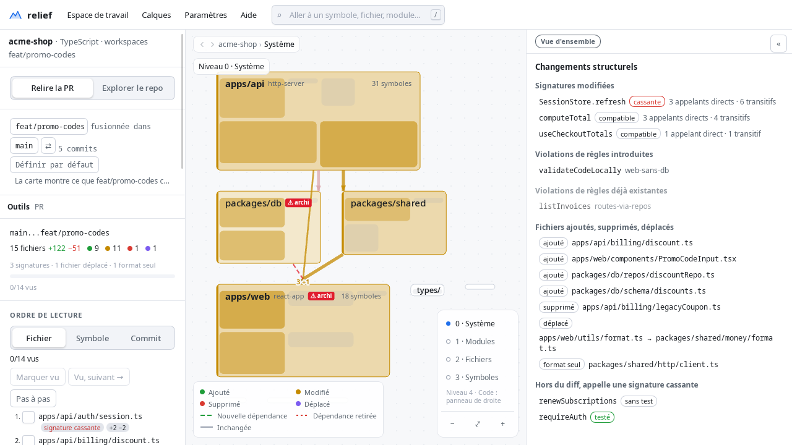
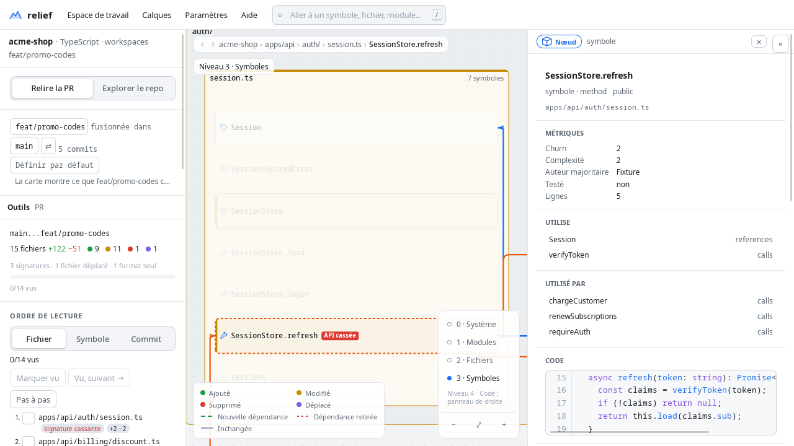

Le dépôt vu comme une carte zoomable.

## L'écran

- **Barre du haut** : le nom du dépôt, suivi des langages lus et du detector utilisé (par exemple « TypeScript · workspaces » ; masqués sur une fenêtre étroite), la ref affichée, la plage de commits, le champ de recherche et le bouton **Paramètres** (⚙). Ce menu regroupe le thème (Clair, Sombre ou Système, qui suit le réglage du système), la langue (English ou Français), les **Raccourcis clavier** (aussi par la touche `?`) et la **Documentation**. Il se ferme sur `Échap` ou d'un clic à côté.
- **Trois colonnes** : la barre de gauche, la carte au centre et le panneau de droite.
- **Barre de gauche** : en haut, la bascule **Relire la PR / Explorer le repo**. Puis le bloc **Outils**, propre au mode : carte de la PR, ordre de lecture, signaux et règles en relecture ; points d'entrée, hotspots et règles en exploration. Enfin le bloc **Affichage**, commun aux deux modes : les calques utiles au mode (diff et focus en relecture, risque et couplage logique en exploration), « Masquer les dépendances externes » et la disposition.
- **Redimensionner** : faites glisser la poignée au bord d'une colonne. relief retient la largeur pour la prochaine ouverture. Un double-clic sur la poignée remet la largeur par défaut.
- **Élargir** : le bouton en haut du panneau de droite l'agrandit pour lire plus confortablement, un second clic le remet à sa largeur.
- La langue et le thème changent tout de suite, sans recharger la page, et sont retenus.
- Si l'API répond par une erreur, son message s'affiche à la place de la carte. Un dépôt sans commit l'indique aussi.

## Niveaux : système, modules, fichiers, symboles

La carte est imbriquée : les systèmes (paquets, services, dépendances externes quand elles sont affichées) contiennent des modules, qui contiennent des fichiers, qui contiennent des symboles. Chaque boîte affiche son nom, son type et ses compteurs.

- **Zoom sémantique** : une boîte s'ouvre d'elle-même quand elle devient assez grande à l'écran, et montre alors ses enfants. Une boîte encore fermée laisse deviner ses enfants en silhouettes pâles. Quand on dézoome, le titre d'une boîte ouverte rétrécit avec elle ; quand il deviendrait trop petit pour être lu, il passe dans une étiquette posée sur la bordure haute de la boîte. Une boîte fermée trop petite pour son nom n'en affiche pas. Le nom reste visible au survol.
- **Quatre niveaux** : `0 · Système`, `1 · Modules`, `2 · Fichiers`, `3 · Symboles`. Choisissez-les avec les boutons en bas à droite de la carte ou avec les touches `0` à `3`. Le niveau courant est affiché en haut à gauche de la carte.
- Le niveau 4, le code, s'affiche dans le panneau de droite.

## Zoom et navigation

- **Déplacer** : faites glisser la carte.
- **Zoomer** : la molette zoome autour du curseur ; les boutons `+` et `−` zooment autour du centre.
- **Tout voir** : le bouton `⤢` (ou la touche `0`) recadre la carte entière.
- **Plonger** : un double-clic sur une boîte la cadre et l'ouvre.
- Les changements de cadrage sont animés. Les boîtes hors de l'écran ne sont pas dessinées, ce qui garde la carte fluide sur un gros dépôt.

## Rechercher et se repérer

- **Rechercher** : `/` place le curseur dans le champ de recherche, en haut. Tapez une partie d'un nom de symbole, de fichier ou de module (`refresh`), ou un chemin (`/checkout`). Les meilleurs résultats viennent en premier : le nom exact, puis les noms qui commencent par la requête, puis ceux qui la contiennent. Chaque résultat indique son type et son chemin.
- **Choisir** : les flèches haut et bas parcourent les résultats, Entrée (ou un clic) sélectionne le résultat. La carte cadre alors le fichier du symbole et l'ouvre jusqu'au symbole. Échap ferme la liste et vide le champ.
- Tant que le curseur est dans le champ, les touches tapées ne déclenchent aucun raccourci.
- La recherche par route HTTP (`POST /checkout`) n'est pas encore disponible : cherchez le chemin du fichier.
- **Fil d'Ariane** : en haut à gauche de la carte, le chemin du nœud sélectionné, par exemple `acme-shop › apps/api › auth/ › session.ts › SessionStore.refresh`. Un clic sur un ancêtre le sélectionne et le cadre. Sans sélection, le fil affiche le niveau courant.
- **Précédent / suivant** : chaque sélection (nœud, arête, résultat de recherche, lien d'un panneau) est une étape d'un historique. Les deux flèches à gauche du fil d'Ariane, `Alt` + `←` / `→` ou les boutons latéraux de la souris reviennent à l'étape précédente ou suivante, sélection et cadrage compris. Déplacer ou zoomer à la main n'ajoute pas d'étape ; changer de plage vide l'historique.
- **Échap**, hors du champ de recherche : désélectionne d'abord le nœud, puis remonte d'un niveau à chaque appui, jusqu'à tout voir.

## Raccourcis clavier

La touche `?` (ou le bouton « ? » de la barre du haut) ouvre la liste des raccourcis ; Échap la ferme.

| Touche            | Action                                                                   |
| ----------------- | ------------------------------------------------------------------------ |
| `0` à `3`         | Niveau de zoom : système, modules, fichiers, symboles                    |
| `/`               | Rechercher                                                               |
| `?`               | Afficher l'aide des raccourcis                                           |
| `Alt` + `←` / `→` | Étape précédente / suivante de l'historique                              |
| `Échap`           | Fermer l'aide, désélectionner, puis remonter d'un niveau, puis tout voir |

## Inspecter un nœud

Le panneau de droite est un inspecteur. Son en-tête dit ce qu'il montre : un badge **Nœud** (avec son type), **Arête** (avec son type de lien) ou **Vue d'ensemble** quand rien n'est sélectionné, et un bouton ✕ qui désélectionne. En exploration, sans sélection, il invite à cliquer un nœud ou une arête.

Sélectionner un nœud (clic, recherche puis Entrée, fil d'Ariane) l'ouvre dans le panneau de droite :

- **Identité** : nom, type, visibilité et chemin du fichier ou du dossier.
- **Enfants** : pour un système, un module ou un fichier, ses enfants, dans l'ordre du code source.
- **Utilise** et **Utilisé par** : les liens fins vers et depuis ce nœud, chacun avec son type (appel, import, référence…). Un clic sur un lien sélectionne le nœud lié.
- **Dépend de** et **Utilisé par** (arêtes) : les flèches de la carte qui partent de ce nœud ou y arrivent, au niveau affiché. Un clic sur une ligne sélectionne l'arête.
- **Code** : le code du fichier ou du symbole, avec ses numéros de ligne et une coloration syntaxique légère.

Le panneau ne montre que des faits tirés de git et du graphe : aucun texte n'est généré.

Sur la carte, les arêtes du nœud sélectionné ressortent : les sortantes en couleur d'accent, les entrantes en couleur d'impact, plus épaisses ; les autres arêtes s'estompent, tout comme les nœuds qui ne sont pas ses voisins directs. Les arêtes internes au nœud sélectionné, entre deux de ses enfants, sont masquées : seules ses dépendances vers l'extérieur restent. Une arête sélectionnée reste seule nette avec ses deux extrémités. `Échap` ou un clic dans le vide rétablit tout.

## Lire les dépendances

Les flèches entre les boîtes sont les dépendances du code : imports, appels, rendus de composants, références et dépendances de paquets.

- **Agrégées au niveau visible** : chaque lien fin (par exemple un appel d'une fonction à une autre) est rattaché à la première boîte visible qui contient chacune de ses extrémités. Au niveau Système, tous les liens de `apps/web` vers `packages/db` forment une seule flèche. Les liens internes à une boîte, ou entre une boîte et son propre contenu, ne sont pas dessinés.
- **Sens et poids** : la flèche va de la boîte qui dépend vers celle dont elle dépend. Plus elle compte de liens, plus elle est épaisse. Le nombre de liens est écrit sur la flèche à partir de deux liens. Une flèche trop courte à l'écran (moins de 60 px) ne porte pas de texte : zoomez pour le voir. En relecture, le texte dit aussi ce que la PR change : `+n` liens ajoutés, `−n` liens retirés, « nouveau » pour une dépendance neuve d'un seul lien, « déplacé », et `⚠ n` sur une flèche qui viole une règle d'architecture.
- **Infobulle** : au survol, une flèche indique ses deux extrémités, son nombre de liens et leurs types, par exemple « apps/web → packages/db · 2 liens (calls, imports) ».
- **Détail** : un clic sur une flèche (ou sur son nombre) l'ouvre dans l'inspecteur : ses deux extrémités en boutons (un clic sélectionne ce nœud), des pastilles (type, précision résolue ou heuristique, nombre de liens, « ajoutée par la PR »), puis la liste des liens fins, chacun avec son type. Un clic sur un lien sélectionne le symbole d'où il part.
- **Utilisations dans le code** : sous les liens, l'inspecteur d'une arête liste où le fichier source se sert de ce qu'il importe, et pas seulement l'import. Les utilisations sont groupées par fichier puis par symbole importé, avec leur nombre ; un import par défaut ou `* as` est groupé sous son nom local (`db` pour `import * as db`, et `db.findUser()` compte comme une utilisation). Chaque ligne donne le numéro de ligne, la ligne de code avec le symbole surligné et la fonction englobante ; un clic ouvre le code à cette ligne. Une arête supprimée est lue côté base. La liste s'arrête à 200 utilisations (« et N de plus »). Un import jamais utilisé l'indique. Pour un langage sans cette analyse (Python pour l'instant), l'inspecteur dit qu'elle n'est pas prise en charge.
- **Dépendances externes** : l'interrupteur **Masquer les dépendances externes**, dans la section **Calques**, retire de la carte les paquets tiers (le groupe des dépendances externes) et les arêtes qui y mènent. Il est actif par défaut, et le choix est mémorisé.
- **Arêtes inchangées** : l'interrupteur de la section **Calques**, dans la barre de gauche, masque ou affiche les flèches. En relecture, il ne garde que les dépendances touchées par le diff.

## Carte de risque

Le calque **Carte de risque**, dans la section Calques, colore chaque nœud selon son risque (complexité × churn, doublé sans test, voir [Hotspots](../explore/#hotspots--où-regarder-en-premier)) : quatre teintes, de la plus claire à la plus soutenue. Une boîte prend la teinte de son élément le plus risqué. Il est coupé par défaut.

## Gros dépôts

Au-delà d'environ 2 000 nœuds, relief n'envoie pas tout le graphe à l'écran d'un coup : il ouvre les premiers niveaux tant qu'ils tiennent, et laisse les autres conteneurs fermés, avec le nombre de leurs enfants. Les dépendances entre conteneurs fermés restent visibles, agrégées.

- **Zoomer** dans un conteneur fermé charge son contenu : un indicateur s'affiche dans la boîte le temps du chargement.
- **Rechercher** (`/`) interroge tout le dépôt, pas seulement ce qui est affiché : choisir un résultat charge les conteneurs qui le contiennent et cadre la carte dessus.

En relecture, relief n'envoie que ce qui sert à la relecture : les nœuds changés, leurs voisins directs et leurs ancêtres ; les autres conteneurs restent fermés. La carte démarre au niveau Fichiers, si bien que les fichiers changés sont visibles sans zoomer.

Sur une carte qui montre beaucoup d'arêtes à la fois (plus de 500 à l'écran), relief ne dessine en entier que celles qui comptent : changées, en violation, sélectionnées ou sur le rayon d'impact. Les autres sont tracées en traits fins, sans flèche ni étiquette ; un clic sur l'un de ces traits sélectionne quand même l'arête et ouvre son inspecteur. Les arêtes dont aucune partie n'est à l'écran ne sont pas dessinées.

## Disposition

La section **Disposition**, dans la barre de gauche, choisit comment les boîtes sont rangées dans leur conteneur.

- **Moins de croisements** (par défaut) : relief change l'ordre des enfants de chaque boîte pour que les flèches se croisent moins aux niveaux Modules, Fichiers et Symboles. La grille et la taille des boîtes ne changent pas, seul l'ordre change. Le calcul est limité à 300 ms : sur un gros dépôt, relief garde le meilleur ordre trouvé dans ce délai. La première boîte de premier niveau reste à sa place.
- **Grille brute** : les boîtes sont rangées par ordre alphabétique.
- Passer d'une disposition à l'autre déplace les boîtes avec une animation. Le choix est retenu pour la prochaine ouverture.
