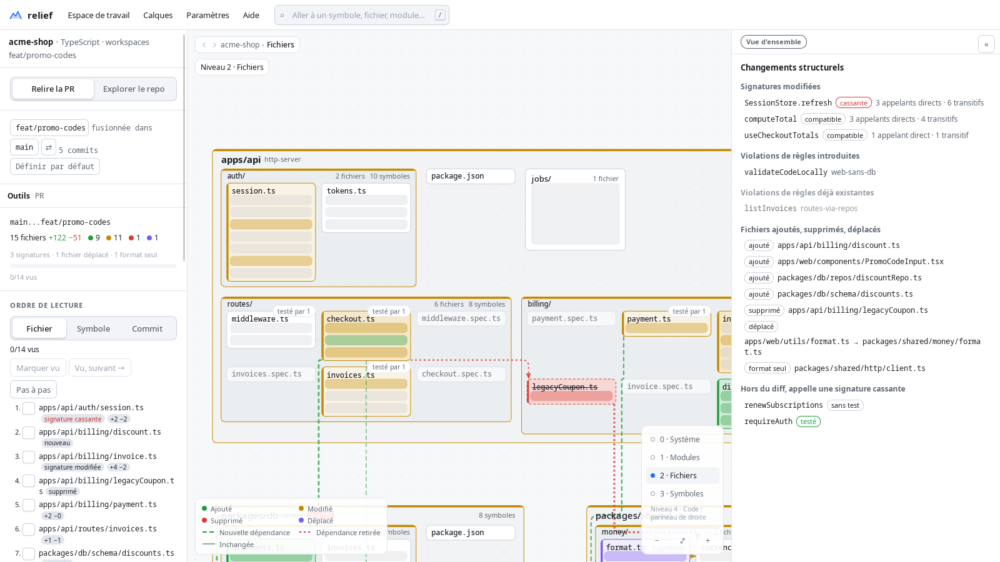
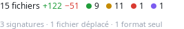
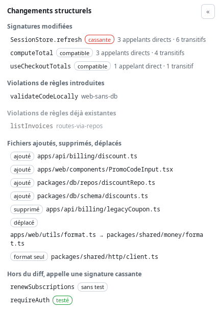
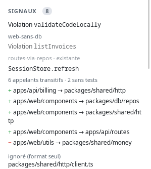
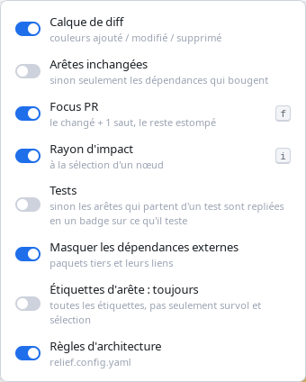
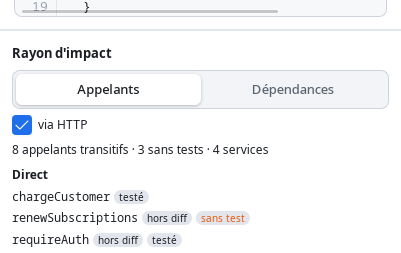
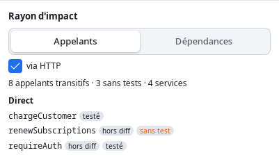
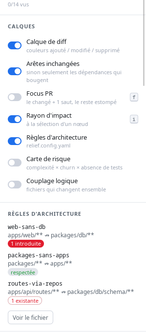
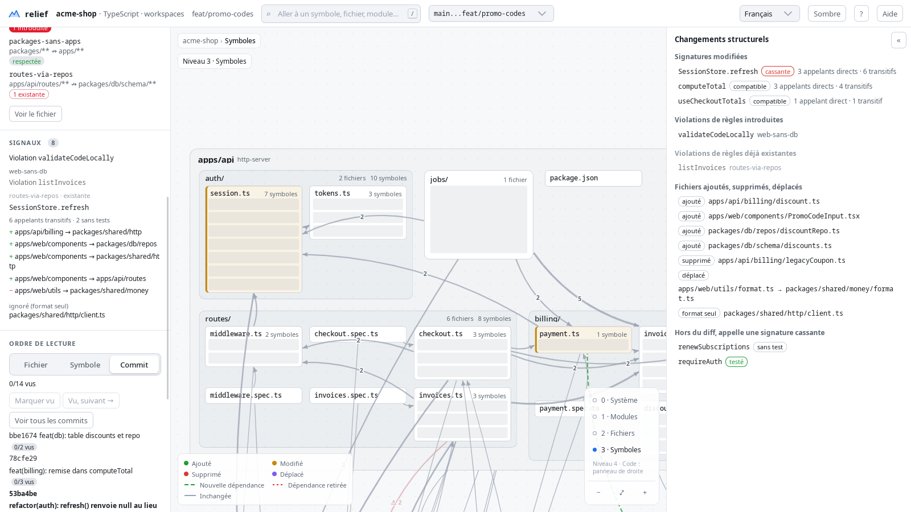

Superposer le diff à la carte : ce qui est ajouté, modifié, supprimé ou déplacé, et les dépendances qui apparaissent ou disparaissent.

## Relire la PR

La bascule **Relire la PR / Explorer le repo**, en haut de la barre de gauche, choisit le mode : relecture ou exploration. Activé, la carte porte le diff de la plage choisie. Coupé, c'est la carte du dépôt seule, sans aucune marque de diff.

## Choisir une plage de commits

Dans la barre du haut, le contrôle **base ···→ head ⇄** choisit ce qu'on compare, suivi du nombre de commits de la plage. Chaque côté porte son rôle : **Référence · base** est le point de départ, **Changements · head** ce qu'on relit. La carte montre ce que head change par rapport à base. Chaque côté (touches `b` et `h`) ouvre une liste avec un champ de filtre, des raccourcis (base : `main`, `HEAD~1`, le dernier tag ; head : **Arbre de travail**, `HEAD`) et trois onglets **Branches**, **Tags** et **Commits**. L'onglet Commits montre l'historique de head, les commits de la plage surlignés et l'autre extrémité marquée BASE ou HEAD. Les flèches, `Entrée`, `Tab` (onglet suivant) et `Échap` s'utilisent au clavier.

- **`···→` ou `→`** : `base...head` (défaut, `···→`) compare depuis l'ancêtre commun, comme une PR ; un clic passe à `base..head` (`→`), le diff direct entre les deux.
- **Ligne de lecture** : sous la barre, une phrase dit ce que montre la carte et quel commit sert vraiment de base, par exemple « ce que feat/promo-codes change par rapport à main, depuis leur ancêtre commun 4e1a9c2 ». Elle s'efface après quelques secondes ou au premier clic sur la carte, et revient au survol du contrôle.
- **⇄** inverse base et head. Il est désactivé quand head est l'arbre de travail, qui est toujours du côté des changements.

Choisir un côté recharge le diff.

- **Dans l'URL** : la plage est gardée dans le paramètre `?range=`. Un lien vers `/?range=main...feat/promo-codes` rouvre donc la même relecture.
- **Au lancement** : `relief . main...feat/promo-codes` ouvre directement cette plage. Sans plage, la carte montre `HEAD` jusqu'à l'arbre de travail.
- Pour l'instant, le sélecteur ne propose que des paires de branches : ni l'arbre de travail, ni l'index.
- Le calcul du diff suit la plage choisie ; la carte, elle, garde le dépôt tel que relief l'a ouvert.

## Relire des changements en cours

Sans plage (`relief .`), relief compare `HEAD` à l'arbre de travail : c'est le moyen de relire ce qu'un agent IA vient d'écrire, avant de committer. Quand la plage touche l'arbre de travail ou l'index, le bouton **Recharger** de la barre du haut relit le dépôt, et relief recharge aussi tout seul quand sa fenêtre reprend le focus. La sélection, le niveau de zoom et l'état « vu » sont gardés ; un nœud qui a disparu est simplement désélectionné. Les plages entre deux commits ne changent pas et ne se rechargent pas.

## Lire le calque de diff

Chaque boîte (système, module, fichier, symbole) porte l'état de ce qu'elle contient.

| Couleur                | Signification                                                 |
| ---------------------- | ------------------------------------------------------------- |
| Vert                   | **Ajouté**                                                    |
| Ambre                  | **Modifié**                                                   |
| Rouge, trait pointillé | **Supprimé**                                                  |
| Violet                 | **Déplacé** ; l'ancien emplacement reste dessiné en pointillé |

- **Intensité** : plus un changement est gros, plus la couleur est marquée. Trois degrés : jusqu'à 5 lignes, jusqu'à 20 lignes, au-delà.
- **Conteneurs teintés** : un module ou un système prend la teinte de ses descendants, pour repérer de loin où se trouve le diff, avant de zoomer.
- **Déplacés** : un fichier déplacé (renommé, par exemple `apps/web/utils/format.ts` vers `packages/shared/money/format.ts`) apparaît une seule fois comme déplacé, avec son ancien emplacement en pointillé. Il n'est pas compté comme un ajout plus une suppression.
- **Format seul** : un fichier dont seul le formatage a changé (aucun symbole ni lien modifié) porte le badge « format seul » : inutile de le relire.

### Badges de signature

Un fichier ou un symbole dont la signature publique change porte un badge :

- **API cassée** : un changement incompatible pour les appelants (paramètre retiré, type de retour différent…).
- **API** : un changement de la signature publique compatible avec les appelants existants.
- **sig. interne** : un changement de signature d'un symbole interne, non exporté.
- **format seul** : voir plus haut.

### Dépendances

- **Nouvelles** : en vert, animées.
- **Retirées** : en rouge, en pointillé.
- **Inchangées** : en gris. Le calque « Arêtes inchangées » les masque pour ne garder que les dépendances touchées par le diff.

Les couplages nouveaux ou disparus sont affichés tels que le cœur de relief les calcule : une flèche nouvelle ou retirée. La section [Signaux](#signaux) les liste entre modules.

Les appels du front vers l'API sont aussi des dépendances : un appel par `fetch` ou par un wrapper (`httpPost("/checkout", …)`) dont le chemin est un littéral est relié à la route serveur déclarée par `app.<verbe>` ou `router.<verbe>`. Les paramètres `:id` et `${…}` servent de jokers. Si le verbe est inconnu, l'arête est marquée heuristique. Un `fetch` sur une URL en variable ne produit aucune arête.

### La légende

Une légende en bas à gauche de la carte rappelle les couleurs : Ajouté, Modifié, Supprimé, Déplacé, Nouvelle dépendance, Dépendance retirée, Inchangée.

## La carte de la PR

Sous la bascule de mode, **La PR** résume la plage :

- la plage relue (`main...feat/promo-codes`) ;

- le nombre de fichiers touchés et les lignes ajoutées (+) et supprimées (−) ;
- le nombre de symboles ajoutés, modifiés, supprimés et déplacés, chacun devant une pastille de sa couleur ;
- le nombre de signatures modifiées, de fichiers déplacés et de fichiers en « format seul » ;
- une barre de progression de la relecture (« 0/14 vus »).

## Vue d'ensemble : changements structurels

Sans sélection, le panneau de droite liste ce que la PR change, calculé depuis le graphe par le cœur de relief (pas de résumé par IA) :

- **Signatures modifiées** : chaque symbole dont la signature change, avec le badge **cassante** ou **compatible**, et le nombre d'appelants directs et transitifs (par exemple « 3 appelants directs · 6 transitifs »).
- **Violations de règles introduites** : à venir. Le groupe n'apparaît pas tant que les règles d'architecture ne sont pas vérifiées dans la relecture.
- **Fichiers ajoutés, supprimés, déplacés** : un fichier par ligne, avec son statut (ajouté, supprimé, déplacé, format seul). Un fichier déplacé montre son ancien et son nouveau chemin.
- **Hors du diff, appelle une signature cassante** : les symboles que la PR ne touche pas mais qui appellent directement une signature cassante, avec le badge **testé** ou **sans test**. Sur acme-shop, `requireAuth` (testé) et `renewSubscriptions` (sans test) appellent `SessionStore.refresh`.
- **Changements répétitifs** : trois fichiers ou plus qui font le même changement (mêmes imports ajoutés ou retirés, mêmes symboles ajoutés ou retirés) forment une seule ligne, par exemple « 4 fichiers : ajoute imports → src/util/helpers.ts ». Le bouton ▸ déplie la liste des fichiers du groupe ; un clic sur un fichier le sélectionne.

Un clic sur une ligne sélectionne son nœud et le cadre sur la carte.

## Signaux

Dans la barre de gauche, la section **Signaux** donne leur nombre et les liste :

- les signatures cassantes, avec « N appelants transitifs · M sans tests » ;
- les nouveaux couplages entre modules (+) et les couplages retirés (−), par exemple `apps/web/components → packages/db/repos`. Les arêtes HTTP comptent aussi : sur acme-shop, `apps/web/components → apps/api/routes` s'ajoute, soit 4 nouveaux couplages ;
- les fichiers ignorés parce que seul leur formatage change ;
- les violations de règles introduites : à venir.

Un clic sur une signature ou un fichier ignoré le sélectionne.

## Calques

La section **Calques** de la barre de gauche regroupe les interrupteurs de l'affichage, chacun avec son raccourci :

- **Calque de diff** : affiche ou masque les couleurs, les badges, les compteurs et les arêtes ajoutées ou retirées. Les nœuds supprimés restent dessinés, sans marque.
- **Arêtes inchangées** : masque ou affiche les dépendances que le diff ne touche pas. En relecture, elles sont masquées par défaut (celles du nœud sélectionné restent visibles) ; en exploration, elles sont affichées. Votre choix est mémorisé pour chaque mode.
- **Tests** : désactivé par défaut, les arêtes qui partent d'un fichier de test (un fichier sous un dossier `test`, `tests`, `__tests__`, `e2e` ou `spec`, ou nommé `*.test.*`, `*.spec.*` ou `*.e2e.*`, et les modules qui ne contiennent que des tests) ne sont pas tracées, pour lire le code d'abord. Les boîtes de test restent sur la carte, atténuées. Ce qu'elles testent porte un badge « testé par N » (« testé par N, dont M nouveaux » en relecture d'un diff). Cliquez le badge, ou sélectionnez un test, pour tracer ses arêtes ; activez le calque pour tout tracer. Votre choix est mémorisé.
- **Focus PR** (touche `f`) : seuls les symboles changés et leurs voisins directs (ce qu'ils appellent et ce qui les appelle) restent nets, avec les boîtes qui les contiennent ; le reste est estompé. Sur acme-shop, `CheckoutPage` reste net, `LoginPage` (à deux sauts du changement le plus proche) est estompé.
- **Rayon d'impact** (touche `i`) : voir [Rayon d'impact](#rayon-dimpact).

## Lire le code

En mode « Relire la PR », sélectionner un symbole ou un fichier changé (clic sur la carte, ou `/` pour chercher) ouvre son **diff structurel** dans le panneau de droite :

- **Diff unifié** : les lignes retirées (−) et ajoutées (+) entre la base et la tête de la plage choisie, avec les numéros de ligne du fichier des deux côtés. Un symbole ajouté n'a que des lignes ajoutées, un symbole supprimé que des lignes retirées. Pour un fichier déplacé, la base est lue à son ancien emplacement.
- **Un bloc par symbole** : pour un fichier, chaque symbole a son bloc, avec son statut (ajouté, modifié, supprimé, déplacé).
- **Format seul** : pour un fichier dont seul le formatage change, le diff texte est masqué (« 58 lignes de diff texte masquées : seul le formatage change »). Le bouton **Afficher quand même le diff texte** l'affiche.
- **Signature** : quand la signature change, le panneau montre l'avant et l'après, le badge **cassante** ou **compatible**, la raison (par exemple « Type de retour élargi (null possible) ») et si le symbole fait partie de l'**API publique** ou est **interne**.
- **élargir** / **réduire** : le bouton de l'en-tête élargit le panneau de droite pour lire les longues lignes.

## Rayon d'impact

Sélectionne un nœud (clic, ou recherche avec `/`) : relief calcule tout ce qui dépend de lui, directement ou de proche en proche. Sur la carte, les nœuds atteints ont un contour orange pointillé, le reste est estompé et les arêtes du chemin passent en orange. Une boîte fermée qui contient des nœuds atteints affiche « ⚡ n ».

Le calque **Rayon d'impact** de la barre de gauche (touche `i`) active ou coupe ce surlignage.

Dans le panneau du nœud, la section d'impact donne :

- le sens : **Appelants** (qui dépend de ce nœud) ou **Dépendances** (ce dont il dépend) ;
- la case **via HTTP**, cochée par défaut et mémorisée : un appel front vers une route de l'API compte comme un appel. Décochée, l'impact s'arrête à la frontière entre services ;
- le compte, le nombre de nœuds sans tests et le nombre de services touchés ;
- la liste par profondeur (« Direct », « À 2 sauts »…), chaque ligne marquée **via HTTP**, **hors diff** (le nœud n'est pas modifié par la plage) et **testé** ou **sans test**.

Sur acme-shop, `SessionStore.refresh` a 8 appelants transitifs via HTTP, 6 sans.

Sur la carte, le premier fichier du groupe (le représentant) reste normal et porte « ×4 identiques » ; les autres membres sont atténués et leurs arêtes modifiées sont repliées dans celles du représentant, avec un compteur. Sélectionner un membre le déplie : ses arêtes et son badge reviennent.

## Ordre de lecture

La section **Ordre de lecture** liste les changements dans l'ordre où les lire : un fichier vient après ceux dont il dépend, pour qu'on ne lise jamais un appel avant ce qu'il appelle. À égalité, l'ordre suit le chemin. Les fichiers qui ne changent que par leur mise en forme et les anciens emplacements des fichiers déplacés n'y figurent pas.

Trois modes :

- **Fichier** (par défaut) : un fichier changé par ligne ;
- **Symbole** : une fonction, une classe ou un type changé par ligne ;
- **Commit** : les commits de la plage, du plus ancien au plus récent (voir plus bas).

Chaque ligne est numérotée et dit pourquoi la lire : signature cassante ou modifiée, nouveau, supprimé, déplacé, et le nombre de lignes ajoutées et supprimées. Sur acme-shop, la PR compte 14 fichiers, ou 22 symboles.

Un groupe de changements répétitifs n'est qu'une seule entrée dans l'ordre de lecture, en mode Fichier : la ligne du représentant porte « ×4 ». Quand tu marques le représentant comme vu, la section propose de marquer tout le groupe.

## Lire pas à pas

Le bouton **Pas à pas** de la section Ordre de lecture ne garde vifs que l'élément courant et ses voisins directs (ce qu'il appelle et ce qui l'appelle, avec les boîtes qui les contiennent). Tout le reste de la carte, flèches comprises, est estompé à 10 %. L'élément courant est l'entrée que tu viens d'ouvrir, sinon la première entrée non vue ; sa ligne est marquée dans la liste.

Les boutons **←** et **→** (ou les touches `p` et `n`) passent à l'entrée précédente ou suivante, et la caméra se cadre sur elle et ses voisins. Le réglage n'est pas gardé d'une session à l'autre. Désactivé, la carte redevient normale et la sélection reste.

## Rejouer commit par commit

En mode **Commit**, chaque ligne est un commit de la plage : SHA court, message, « x/y vus » et, s'il y en a, le nombre de fichiers sans changement structurel (mise en forme seule). Les fichiers du commit sélectionné s'affichent en dessous, dans l'ordre de lecture.

Clique sur un commit pour le rejouer : la carte ne colore que ses changements (nœuds et arêtes) et se cadre sur ses fichiers. Le panneau de diff montre alors ce que ce commit a changé, même si un fichier est touché par plusieurs commits. Clique à nouveau sur le commit, ou sur **Voir tous les commits**, pour revenir à toute la plage. `n` et `p` passent d'un commit à l'autre.

« Vu » est le même qu'en modes Fichier et Symbole : ce qui est marqué dans un commit est vu partout.

## Marquer comme vu

Coche la case d'une ligne, ou utilise **Marquer vu** et **Vu, suivant →** dans le panneau. Au clavier :

- `n` sélectionne l'entrée suivante non vue, `p` la précédente ;
- `v` marque l'entrée sélectionnée comme vue (ou la décoche).

« Vu » se suit par symbole. Marquer un fichier marque tous ses symboles changés, et un fichier est vu quand tous ses symboles changés le sont. Si le fichier change aussi hors de ses symboles (un import, par exemple), cette partie est une entrée de plus à marquer. Ainsi, en mode Symbole, marquer `computeTotal` ne marque pas tout `invoice.ts`.

La progression (« 1/14 vus ») s'affiche en haut de la section. Sur la carte, les nœuds vus sont atténués et les boîtes affichent « x/y vus ».

La progression est enregistrée par dépôt et par plage dans `.relief/state/review/` à la racine du dépôt (un fichier par plage) : elle survit à la fermeture de relief. Pour un dépôt bare ou en lecture seule, elle va dans `~/.cache/relief/`. Si aucun dossier n'est disponible, relief le dit et garde la progression en mémoire jusqu'à la fermeture.
