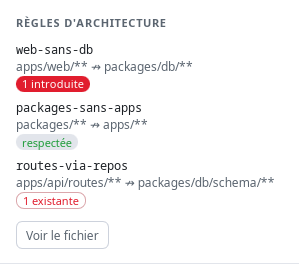

Déclarer et vérifier les dépendances permises.

## Le fichier relief.config.yaml

Les règles se déclarent dans `relief.config.yaml`, à la racine du dépôt. Voici celui d'acme-shop :

```yaml
# relief.config.yaml
rules:
  - id: web-sans-db
    description: 'le front ne parle jamais directement à la base'
    from: apps/web/**
    deny: packages/db/**
  - id: packages-sans-apps
    description: "une lib partagée ne dépend jamais d'une app"
    from: packages/**
    deny: apps/**
  - id: routes-via-repos
    description: 'les routes passent par les repos, pas par le schéma'
    from: apps/api/routes/**
    deny: packages/db/schema/**
```

Chaque règle a :

- `id` : un nom court, unique dans le fichier ;
- `description` : la phrase affichée avec une violation ;
- `from` : les fichiers concernés (glob de chemins) ;
- `deny` : les fichiers dont ils ne doivent pas dépendre (glob de chemins) ;
- `kinds` (facultatif) : les sortes de dépendances vérifiées, par défaut `imports`, `calls`, `references` et `renders`. Les autres (`http`, `depends_on`, `extends`, `implements`) ne sont vérifiées que si `kinds` les nomme.

Dans un glob, `*` remplace un segment de chemin et `**` n'importe quels dossiers.

Le même fichier peut lister des fichiers à ignorer, qui n'apparaissent alors plus sur la carte :

```yaml
exclude:
  - '**/generated/**'
  - '**/*.min.js'
```

Le seuil du [couplage logique](../explore/#couplage-logique) se règle aussi dans ce fichier, sous `co_change: { min_commits: N }`.

### Où relief lit le fichier

relief lit `relief.config.yaml` dans le commit de tête de la plage relue : les règles d'une PR s'appliquent à cette PR, même si elle modifie le fichier. Sans fichier, il n'y a simplement pas de règles.

Si le fichier est invalide (YAML malformé, `id` en double, glob incorrect), relief le signale avec la ligne et la colonne en cause.

### relief.config.yaml ou .relief/

- `relief.config.yaml` est **versionné** : committé avec le code, il décrit l'architecture voulue et il est le même pour toute l'équipe.
- `.relief/` est **local** : relief y range son cache et la progression de relecture. Il est ignoré par git et propre à chaque copie de travail.

## Violations

Une dépendance d'un fichier de `from` vers un fichier de `deny` est une violation. relief en distingue deux sortes :

- **introduite** : la dépendance n'existait pas dans la base de la plage, c'est la PR qui l'ajoute ;
- **existante** : elle existait déjà avant la PR. C'est de la dette, montrée plus discrètement.

Un import suivi d'un appel vers le même fichier compte pour une seule violation.

### Dans la carte

La section **Règles d'architecture** de la barre de gauche liste chaque règle (`from ↛ deny`) avec son bilan : « 1 introduite », « 1 existante » ou « respectée ». Sur acme-shop, `web-sans-db` a 1 violation introduite, `packages-sans-apps` est respectée et `routes-via-repos` a 1 violation existante.



- Clique sur une règle pour sélectionner son arête fautive : le panneau de l'arête montre la règle (description, chemins, globs) et dit si la violation est introduite par cette plage ou existait déjà sur la base.
- **Voir le fichier** affiche le `relief.config.yaml` lu par relief, dans le panneau, sans rien ouvrir à l'extérieur.
- Sur la carte, une violation introduite est une arête rouge animée marquée « ⚠ n », une violation existante une arête rouge discrète. Les nœuds concernés portent le badge « ⚠ archi » (en relecture, pour les violations introduites seulement).
- Le calque **Règles d'architecture**, dans le menu Calques, affiche ou masque ces marques.
- Les violations introduites comptent dans les Signaux et la vue d'ensemble ; les existantes y sont listées à part.
