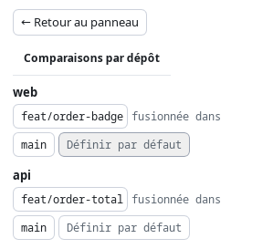
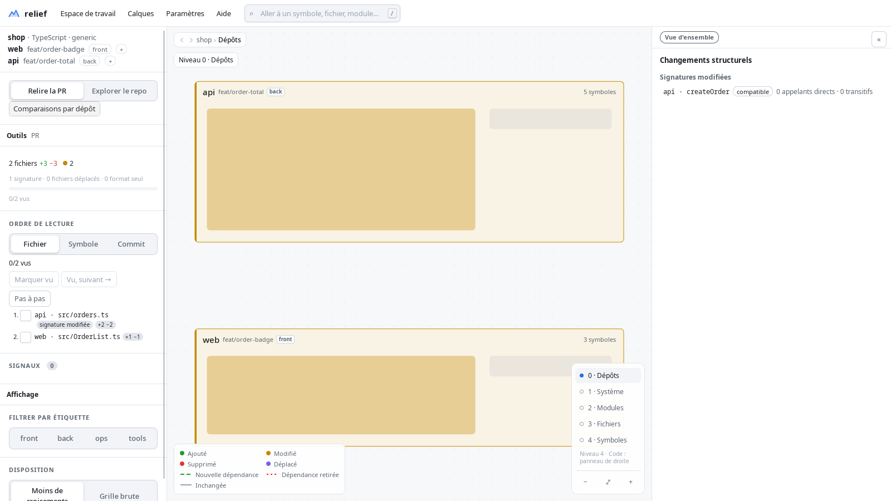

Un espace de travail regroupe plusieurs dépôts (un front, une API, une bibliothèque partagée) pour relire un changement qui les traverse sur une seule carte. Cette page le prend de A à Z ; le format du fichier est détaillé dans [Commencer](../getting-started/#espace-de-travail).

## Créer un espace depuis l'accueil

1. Lancez `relief` sans argument : l'écran d'accueil s'affiche.
2. Cliquez **Créer un espace de travail…** (aussi dans le menu **Espace de travail**).
3. Choisissez le dossier de l'espace.

relief crée dans ce dossier `.relief/` et le fichier d'espace `<nom-du-dossier>.relief.json`, puis ouvre l'espace, vide pour l'instant : ajoutez-y vos dépôts (section suivante). L'espace rejoint les récents de l'accueil.

Depuis un dépôt déjà ouvert, le menu **Espace de travail** > **Ouvrir ce dépôt comme espace de travail** demande le dossier de l'espace et y crée `<nom-du-dépôt>.relief.json` avec ce dépôt. Le dossier ne doit pas être dans le dépôt. Pour un espace existant, utilisez **Ouvrir un espace de travail…** (accueil ou menu).

## Ajouter des dépôts

Dans un espace, **Espace de travail** > **Ajouter un dépôt à l'espace…** ouvre le sélecteur de dossier ; le dépôt choisi (par exemple l'API) est ajouté au fichier d'espace et la carte se recharge. Le nom d'un dépôt est unique dans l'espace ; l'entrée est grisée hors d'un espace.

Les dépôts membres restent intacts : relief n'écrit rien dedans.

## Étiqueter

L'en-tête de la barre de gauche liste chaque dépôt avec sa branche et ses étiquettes. Le bouton **+** d'un dépôt propose `front`, `back`, `ops`, `tools` et vos propres étiquettes ; un clic ajoute ou retire. Le choix est écrit dans le fichier d'espace et s'affiche sur la boîte du dépôt. **Filtrer par étiquette** (section **Affichage**) masque les dépôts sans l'étiquette choisie. Détails dans [La carte](../map/#étiqueter-les-dépôts-dun-espace).

## Comparer chaque dépôt

Chaque dépôt se compare sur sa propre plage : par défaut, son arbre de travail contre `main`, sinon `master`, sinon sa branche courante. Le bouton **Comparaisons par dépôt** (sous la bascule Relecture / Exploration) liste une ligne par dépôt, où l'on change la source ou la destination ; **Définir par défaut** l'écrit dans le fichier d'espace. Détails dans [Relire une PR](../review/#comparer-chaque-dépôt-dun-espace).

Un changement qui touche le front et l'API apparaît ainsi sur la même carte : au niveau **Dépôts**, les deux boîtes sont marquées ; en descendant aux fichiers, les fichiers modifiés de chaque dépôt le sont aussi, avec l'ordre de lecture et l'impact sur l'ensemble.

## Suivre une flèche entre dépôts

Deux liens relient les dépôts :

- un **import de paquet** : quand un dépôt importe un paquet qu'un autre dépôt de l'espace publie (le `name` d'un `package.json` ou d'un `pyproject.toml`), la flèche va vers le point d'entrée du paquet, et non vers une dépendance externe ;
- un **appel HTTP** : un appel comme `fetch("/orders")` est relié à la route `GET /orders` déclarée dans un autre dépôt, par la même règle qu'à l'intérieur d'un dépôt.

Au niveau **Dépôts**, ces liens sont regroupés en une flèche d'un dépôt à l'autre ; cliquez-la pour lister ses liens et leurs usages. Dans l'onglet Relecture, les flèches inchangées sont masquées par défaut : activez **Arêtes inchangées** pour voir celles qui n'ont pas bougé. L'impact d'un changement de route atteint les appelants à travers les dépôts.

## Lire le code, chercher, parcourir l'historique

Tout ce qui se fait sur un nœud ou une flèche marche en espace de travail, à la plage du dépôt concerné : le code d'un fichier ou d'un symbole (côté base ou côté tête), son diff texte, les usages d'une flèche, y compris entre deux dépôts. La recherche (`/`) couvre tous les dépôts, et le mode Exploration (churn, propriétaires, co-changement) aussi ; le co-changement ne relie que des fichiers d'un même dépôt.

Il n'y a pas d'ordre commun entre les commits de dépôts différents. Le journal et la lecture par commit listent donc les commits de chaque dépôt l'un après l'autre, dans l'ordre du fichier d'espace, chacun précédé du nom de son dépôt (la plage `rev` demandée est ignorée : chaque dépôt est lu depuis sa source, et la limite s'applique à chaque dépôt). Il en va de même du mode Exploration : les métriques et le co-changement lisent chaque dépôt à sa source.

## Limites

- Les règles d'architecture (`relief.config.yaml`) ne sont pas évaluées en espace de travail.
- La comparaison d'un dépôt se règle dépôt par dépôt ; il n'y a pas de plage commune à l'espace.
